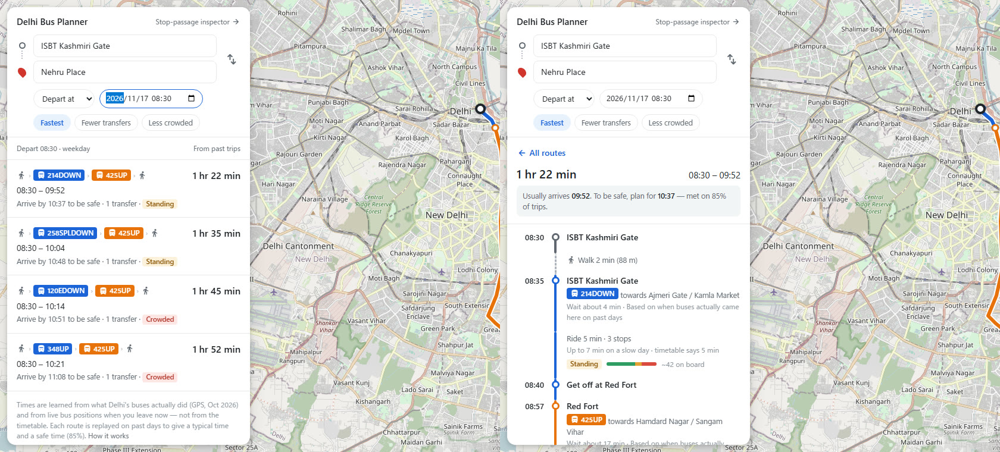

# Delhi bus journey planner from observed GPS — Transport Stack Hackathon 2026

Team **Promon** (Doshisha University, Miyazaki Seminar) · Phase 1 submission for
**Problem 1: Real-time bus traffic model and journey planner**
([Transport Stack Hackathon 2026](https://delhi.transportstack.in/hackathon/)).



## Submission at a glance

| What the brief asks for | Where it is |
|---|---|
| Proposal | [`docs/proposal.md`](docs/proposal.md) |
| A documented API that returns journey options as JSON | `GET /journeys` — [API](#api) below; interactive docs at `/docs` when running |
| A simple map-based screen to inspect the results | `http://localhost:8000/` (screenshot above); stop-passage inspector at `/passages` |
| Short technical note: linking GPS to routes, travel time per stretch, combining live and historical data | [`docs/technical_note.md`](docs/technical_note.md), sections 2–4 |
| Validation report: estimates vs actual bus trip times **and vs Google Maps** for the same pairs and times | [Results](#results) below; method and details in the technical note, sections 5–7 |
| Code and instructions that let someone else run the system | [Run](#run) below; code in `app/` and `src/tsh/` |
| Short demo video | uploaded with the submission form |
| Full lab notebook, every experiment including failures (Japanese) | [`docs/phase1_prototype.md`](docs/phase1_prototype.md) |

## In one paragraph

Delhi's GTFS timetable does not describe what buses do: ride times are off by 25%, and leaving at the latest time the
timetable allows gets you there on time only 30% of the time. We rebuilt **when every bus passed every stop** from the
October 2026 GPS (96% of passages), learned ride times and waits from those passages, use live GTFS-RT positions when
you leave now, and **replay every recommended journey on past days** to give a median time and an honest
"safe arrival" (85th percentile). Everything is validated on a held-out week by replaying the recommended journey on
that week's real GPS, and compared with Google Maps on the same trips.

## Results

Held-out test week 25–31 Oct 2026, never used while building. Models trained on 1–24 Oct; every tuned value was
chosen on 18–24 Oct only. "Actual" = what happened when the recommended journey is followed on the test week's GPS.

**Against actual bus trip times and the GTFS timetable**

| | This prototype | GTFS timetable |
|---|---|---|
| Ride time, median abs. error (20,000 rides) | **9.4%** (10.5% without live data) | 25.2% |
| Wait + ride from a stop, median abs. error (3,000 cases) | **20.4%** | 36.5% |
| Door-to-door, **leaving now** (600 OD pairs, top option replayed on GPS) | **13.6%** | 25.3% |
| Door-to-door, **planning ahead** | **16.1%**; ±10 min 43.6%; picked the actually fastest 67.5% | 24.1% |
| "Safe" arrival met (target 85%) | 79.1% leaving now · 76.3% planning ahead | — |
| **Arrive by** a given time: arrived in time | **79.6%** | 29.6% (57% > 10 min late) |
| Query time | ~1–4 s | — |

**Against Google Maps** (same pairs and departure times; Google = Routes API, transit with buses only; technical
note 6.1)

| Door-to-door, median abs. error | This prototype | Google Maps | GTFS timetable |
|---|---|---|---|
| Planning ahead (378 pairs) | **15.4%** | 29.3% (median 18.5 min too optimistic) | 23.9% |
| Leaving now (357 pairs) | **13.8%** | 27.7% | — |
| Each estimate against its own route replayed on GPS (89 pairs) | **17.6%** | 32.2% | — |

The gap to Google when planning ahead is −13.9 points (95% bootstrap interval −16.8 to −9.7). Google's
API does not accept past departures, so it was asked about the same weekday and time in the week of 30 Nov 2026.

Why the remaining error is mostly waiting (short-turning, line switching, missed trips) and what did not work:
[`docs/technical_note.md`](docs/technical_note.md), section 7.

## API

`GET /journeys` returns up to 6 journey options (direct or one transfer, walking up to 800 m).

| Parameter | Meaning |
|---|---|
| `from`, `to` | `lat,lng` |
| `depart` | ISO 8601 in India time, e.g. `2026-11-17T08:30`. Default: now (live bus positions are used) |
| `arrive` | Arrive-by time instead of `depart`: returns the latest departure that made it on 85% of past days |
| `sort` | `fastest` (default), `comfort` (crowding-weighted) or `fewer_transfers` |
| `n` | number of options, 1–6 (default 3) |
| `realtime` | `false` to ignore live positions |

Example: `GET /journeys?from=28.6676,77.2285&to=28.5494,77.2510&depart=2026-11-17T08:30&n=1` (shortened):

```json
{
 "depart": "2026-11-17T08:30:00", "day_type": "weekday", "sort": "fastest",
 "options": [{
   "total_min": 82.0, "arrive": "09:52", "arrive_safe": "10:37",
   "walk_min": 5.1, "wait_min": 20.7, "ride_min": 52.0, "transfers": 1, "crowding_worst": "standing",
   "total_source": "Replayed on 21 past days of the same type (arrived on 100% of them), recalibrated so that it matched actual trip times on a calibration week",
   "legs": [
    {"mode": "walk", "to_stop": "ISBT Kashmiri Gate", "minutes": 1.5, "meters": 88},
    {"mode": "bus", "route": "214DOWN", "headsign": "New Seema Puri to Ajmeri Gate / Kamla Market",
     "board": {"stop": "ISBT Kashmiri Gate", "seq": 16}, "alight": {"stop": "Red Fort", "seq": 19}, "stops": 3,
     "board_time": "08:35", "wait_min": 3.5, "wait_source": "when buses actually passed this stop on past days",
     "ride_min": 5.1, "ride_min_p85": 6.6, "ride_min_timetable": 4.6,
     "crowding": {"level": "standing", "load": 42, "prob": {"seats": 0.57, "standing": 0.14, "crowded": 0.29}, "confidence": "high"}},
    "…"
   ]
 }]
}
```

- `arrive` is the median arrival, `arrive_safe` the 85th percentile; `wait_source` says where each wait came from
  (live bus upstream, bus about to turn back at the terminus, or past passages); `ride_min_timetable` is the GTFS
  time for comparison; `crowding` comes from e-tickets.
- Other endpoints: `GET /stops?q=nehru` (stop search), `GET /live` (status of the live feed), `GET /health`.

## Run

```bash
pip install -r requirements.txt
python -m uvicorn app.server:app --app-dir . --port 8000
# http://localhost:8000/  (planner)   http://localhost:8000/passages  (inspector)   http://localhost:8000/docs  (API)
```

The server needs the passages and models built from the raw data (not in the repository, see [Data](#data)).
Live waits need a Delhi Transport Stack GTFS-RT key in `.env` (`DTS_API_KEY=…`); without it the planner uses history.

**Rebuild from the raw data** (run from the repository root with `PYTHONPATH=src`; times on a 20-core laptop):

```bash
python scripts/gps_to_parquet.py all            # GPS SQLite -> Parquet, de-duplicated (~30 min)
python -m tsh.passages                          # stop passages, GPS point within 60 m (inspector, live link speeds)
python -m tsh.passages_v2                       # stop passages by projecting GPS onto the route and interpolating (96%)
python -m tsh.passages_term                     # terminal fill, used only for the ground truth
python -m tsh.traveltime schedule               # GTFS timetable times (baseline)
python -m tsh.traveltime train                  # travel-time tables on 1-24 Oct (for validation)
python -m tsh.traveltime all                    # travel-time tables on the whole month (for the API)
python -m tsh.seg_ml                            # LightGBM ride models (median and quantiles)
python -m tsh.crowding tickets                  # match e-ticket stop names to GTFS stops (~10 min)
python -m tsh.crowding all                      # crowding per route x segment x hour
python -m tsh.validate_journeys plancal         # calibration week 18-24 Oct, planning ahead
python -m tsh.plan_calib                        # -> quantile recalibration used by the API
python -m tsh.validate_journeys livecal         # calibration week, leaving now
python -m tsh.live_excess                       # -> distribution of live-wait misses used by the API
python -m tsh.recorder                          # optional: record GTFS-RT for live link speeds
```

**Reproduce the validation**: `python -m tsh.validate_p1` (ride and wait), `python -m tsh.validate_journeys`
(planning ahead), `python -m tsh.validate_journeys live` (leaving now), `python -m tsh.validate_journeys arrive`
(arrive by), and `python experiments/p1_google/compare.py pairs|fetch|replay|score` (Google Maps; needs
`GOOGLE_MAPS_API_KEY` in `.env`). Metrics are written to `results/*.json`.

Code map: `src/tsh/passages*.py` (stop passages), `traveltime.py`, `seg_ml.py` (ride models), `waitmodel.py`,
`realtime.py`, `live_excess.py` (waits), `planner.py` (search, replay, calibration), `validate_*.py` (evaluation),
`app/` (API and screens), `experiments/` (one folder per investigation), `results/` (metrics JSON). Code comments
are in Japanese; all user-facing text, the API and the documents above are in English.

## Data

Data comes from [Delhi Transport Stack](https://delhi.transportstack.in) and is **not** committed (see `.gitignore`).
Place downloaded files under `data/raw/`:

| Folder | Dataset | Size |
|---|---|---|
| `data/raw/bus_gps/` | Bus GPS, DTC, Oct 2026 | 16.1 GB .7z / 124 GB unpacked |
| `data/raw/gtfs_static/` | Delhi Buses: GTFS Static (DTC / DoT), feed v32 | 30 MB .zip |
| — | Delhi Buses: GTFS-RT feed (API, `x-api-key`) | ~0.6 MB per call |
| `data/raw/ticketing/` | Bus e-ticketing, Oct 2026 (used for crowding, below) | 66 MB .zip |

Details: [`docs/data.md`](docs/data.md).

## Also in this repository: crowding (Problem 2 work)

The planner also shows expected crowding per leg (seat / standing / crowded probabilities) estimated from e-tickets:
91.4% of tickets matched to both stops on the GTFS route; week-to-week error 31% at route × segment × hour, of which
20% is the noise floor of app tickets alone. Details (Japanese): `docs/phase1_prototype.md` sections 6–7, 13 and 15.

## Credits

- Open-source libraries: DuckDB, pandas, NumPy, Polars, PyArrow, LightGBM, SciPy, RapidFuzz, FastAPI, Uvicorn,
  Matplotlib, gtfs-realtime-bindings, py7zr, Playwright (demo recording), Leaflet, Material Symbols icons; map tiles
  © OpenStreetMap contributors.
- Data: Delhi Transport Stack (DTC bus GPS, GTFS static, GTFS-RT via Open Transit Data).
- Comparison baseline: Google Maps Platform Routes API (only aggregate error statistics are stored in this repository).
- AI tools: code, analyses and documents were developed with **Claude Code (Anthropic)** as an AI pair-programmer and
  research assistant. All reported numbers come from running the code in this repository on the hackathon data.
- Methods we build on are cited in the technical note and the lab notebook (e.g. quantile recalibration,
  Kuleshov et al. 2018; robust routing from past days, Böhmová et al. 2013/2015; optimizer's curse, Smith & Winkler 2006).
