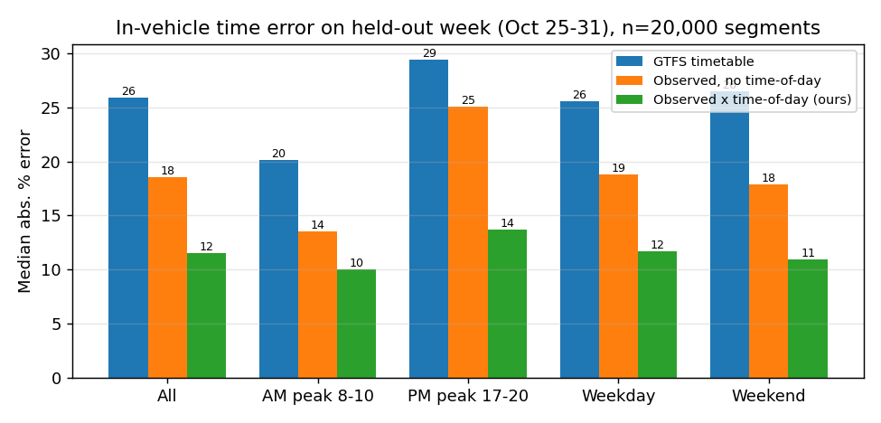
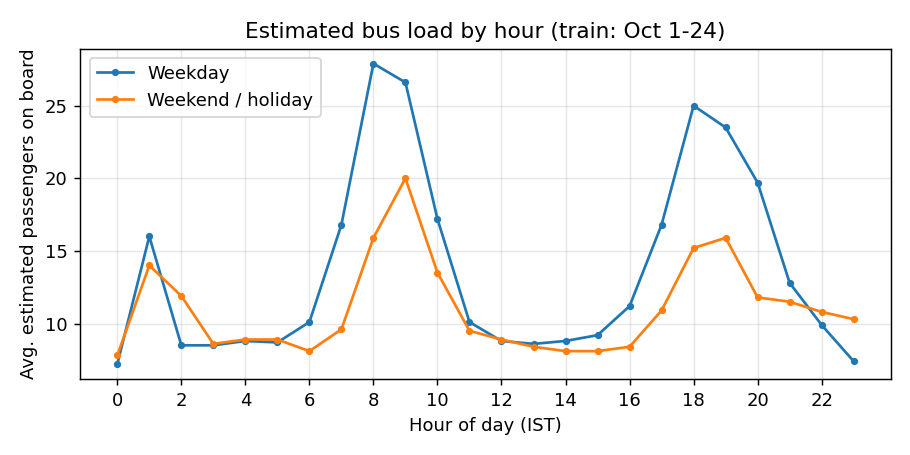

# Phase 1 試作：問題1・問題2 の作成過程と精度検証

作成日: 2026-11-15
対象: 問題1（観測 GPS にもとづくバス所要時間＋経路検索 API）と 問題2（乗車券にもとづく混雑度つき経路検索）
データ: 2026年10月のバス GPS（DTC、31日分）・電子乗車券（約256万件）・GTFS Static v32・GTFS-RT（API）。入手の詳細は [data.md](data.md)。

> 結論（先に）
> - **問題1**：区間 × 平日/休日 × 時間帯の中央値という単純なモデルで、検証週（10/25〜31）の乗車時間の誤差（中央値）は **11.5%**。GTFS 時刻表（25.9%）の半分以下。夕方ピークでは時刻表 29.4% → 13.7%。
>   待ち時間を含めた所要時間は、過去データだけでは誤差が大きい（中央値 34%）。**リアルタイムの GPS で手前のバスが見えているとき（約47%）は 15.9% まで下がる**。
> - **問題2**：乗車券の 79% を路線上の乗車・降車停留所に対応づけ、路線 × 区間 × 時間帯の車内人数を推定。平日の朝 8〜9 時・夕 18〜19 時にピーク、休日は低く平ら（既知のパターンと一致）。前の3週間から作った推定は、最後の1週間の推定と **相関 0.83（信頼度「高」）・混雑レベル一致 74〜80%・1段階以内 97%**。
> - 経路検索 API と地図の画面は動作する。ランダムな 200 組の出発地・目的地で **100% 経路あり、検索 0.13 秒（中央値）**。
> - **Google Maps との比較はまだ**（API キーが無い）。やり方は 5 章に書いた。

---

## 1. 全体の構成

```
data/raw/bus_gps/*.7z ──(scripts/gps_to_parquet.py)──▶ data/interim/bus_gps/  （GPS 5.7 GB）
GTFS stops/trips/stop_times ──(tsh.common.patterns)──▶ data/processed/patterns.parquet （路線ごとの停留所の並び）
GPS × patterns ──(tsh.passages)──▶ data/interim/stop_passages/  （どの便が何時にどの停留所を通ったか）
stop_passages ──(tsh.traveltime)──▶ data/processed/{train,all}/link_*.parquet, route_wait.parquet  ← 問題1のモデル
乗車券 × patterns × GPS ──(tsh.stopmatch)──▶ data/processed/tickets_matched.parquet （券の乗車・降車の停留所）
tickets_matched ──(tsh.crowding)──▶ data/processed/{train,test,all}/crowding.parquet         ← 問題2のモデル
両方 ──(tsh.planner + tsh.realtime)──▶ app/server.py（GET /journeys）＋ app/static/index.html（地図）
検証: tsh.validate_p1 / tsh.validate_p2 / tsh.validate_planner → results/
```

- コードは `src/tsh/`、API と画面は `app/`、検証結果は `results/`。
- **学習は 10/1〜10/24、検証は 10/25〜10/31**（時系列で分け、検証週はモデル作成に一切使わない）。画面・API は全31日で作ったモデル（`all`）を使う。
- 祝日 10/2（ガンディー生誕記念日）は休日扱い。

### 再現手順

```bash
pip install -r requirements.txt
python scripts/gps_to_parquet.py all                 # GPS を Parquet に（約20分）
PYTHONPATH=src python -m tsh.passages                # 停留所の通過を検出（約2分）
PYTHONPATH=src python -m tsh.traveltime schedule     # 時刻表（比較用）
PYTHONPATH=src python -m tsh.traveltime train        # 問題1モデル（学習期間）
PYTHONPATH=src python -m tsh.traveltime all          # 問題1モデル（全期間、API 用）
PYTHONPATH=src python -m tsh.crowding tickets        # 停留所名の照合（GPS の別名を含む。初回は約10分）
PYTHONPATH=src python -m tsh.crowding train          # 問題2モデル（学習期間）
PYTHONPATH=src python -m tsh.crowding test           # 問題2（検証期間、比較用）
PYTHONPATH=src python -m tsh.crowding all            # 問題2（全期間、API 用）
PYTHONPATH=src python -m tsh.validate_p1             # 問題1の検証（約5分）
PYTHONPATH=src python -m tsh.validate_p2             # 問題2の検証
PYTHONPATH=src python -m tsh.validate_planner        # 経路検索の網羅性
python -m uvicorn app.server:app --app-dir . --port 8000   # http://localhost:8000
```

---

## 2. データのつなぎ方（最初に調べたこと）

| つなぐもの | 方法 | 一致率 |
|---|---|---|
| GPS の `route_id` ↔ GTFS `route_id` | そのまま | 99.8%（GTFS は上り・下りが別の route_id） |
| 乗車券の `route`（例 `8UP`）↔ GTFS `route_short_name` | そのまま | 乗車券の行の 98.2% |
| 乗車券の `vehicle_number` ↔ GPS の `vehicle_id` | そのまま | 98%（ただし乗車券の 48.5% は車両番号が空欄） |
| GPS の `trip_id`（例 `1728_21_54_1365`）↔ GTFS の `trip_id`（例 `1000_FULL_06_10`） | 形式が違い、直接はつながらない | — |

GPS の便 ID は GTFS の便とつながらないので、**GPS の点を「路線の停留所の並び」に重ねて、停留所の通過時刻を自分で作る**方針にした。

### 路線の代表パターン（`tsh.common.patterns`）
GTFS では1つの route_id に、全区間の便（FULL）と区間便（SHORT）など複数の停留所列がある。FULL の便で最も多い停留所列を代表とした。2,574 路線、平均 32 停留所・18 km。

---

## 3. 問題1：所要時間モデルの作り方

### 3.1 停留所の通過の検出（`tsh.passages`）
1. GPS の各点を、その点の route_id の代表パターンの停留所と突き合わせ、**60m 以内**の停留所を候補にする。
2. 便（日付・車両・trip_id）× 停留所ごとに、**最も近づいた点の時刻**を通過時刻とする。
3. 停留所の順番どおりに時刻が増えていない通過（GPS のずれ・同じ停留所の再通過）を除く。
4. 通過が 5 停留所未満の便は捨てる。

結果: 31日で **約3,553万件の通過・約164万便**（1日あたり約5万便）。1日2〜4秒で処理できた。

GPS の点の間隔は中央値11秒（90%点22秒、2分を超える空白は0.6%）。通過とみなした点と停留所の距離は中央値17.5m、90%点43.7m（10/15）。

**確かめる画面**（`app/viz.py`・`app/static/passages.html`、2026-11-16 追加）: `http://localhost:8000/passages` で、路線・日付・便を選ぶと次が見える。
- 地図: 路線の形（GTFS の shapes.txt）、停留所（判定で色分け：通過・近くを通ったが順番の確認で除外・60m 以内に点なし）、停留所のまわり 60m の円、その便の GPS の点（時刻で色が変わる）、通過とみなした点と停留所を結ぶ線。再生ボタンでバスの動きと停留所の通過を順にたどれる。
- 停留所ごとの表: 通過時刻、前に検出した停留所からの時間と速さ、判定。未検出の停留所は最も近い点までの距離。
- 時間・距離の図（マーレイ図）: 横が時刻、縦が始点からの距離。同じ日の全便の通過と時刻表を重ね、選んだ便は GPS の点も描く。線の傾きが速さ、線の間隔が運行間隔を表すので、渋滞（線が寝る）や団子運転（線が近づく）、時刻表とのずれが一目で分かる。
- 同じ系統の全バス（同日追加）: その日にこの系統（上り・下り）を走った全バスを、再生の時刻に合わせて地図の上で同時に動かす（青＝同じ向き、紫＝逆向き、橙＝選んだ便）。バスをクリックするとその便に切り替わり、逆向きなら路線も切り替わる。764UP（10/15）では9時に同じ向き18台・逆向き15台が走っている。時間の範囲を「1日全体」にすると5〜24時を通して再生できる。API は `GET /viz/api/fleet`（GPS を30秒おきに間引く）。
- 停留所ごとの検出率（同日追加）: その日、前と後の停留所で通過を検出した便（＝確実にそこを通った便）のうち、その停留所でも検出できた便の割合。最初・最後の停留所は率を出さない。764UP（10/15、191便）では中央値80%、70%未満が20か所。
- 規模の表示（同日追加）: 検出は1便だけでなく、10月の全体で 2,079 路線（時刻表の 2,574 路線のうち）・6,644 台・約164万便・約3,553万回の通過を検出している（`GET /viz/api/overview`）。

**検出の取りこぼし**（10/15、全路線）: 確実に通った便のうち、その停留所で通過を検出できたのは **77.3%**（路線×停留所 50,265 組の中央値 83%、50%未満の停留所が 9.7%、70%未満が 25.1%）。約4分の1の通過を取りこぼしている。所要時間は検出できた停留所どうしの間で数えるので値が偏るわけではないが、停留所ごとの時刻の材料が減る。13.3 の補間に替えれば、この率がどこまで上がるかで効果を測れる。

### 3.2 区間所要時間（`tsh.traveltime.build`）
- 同じ便で続けて検出された2つの停留所（間の未検出が4停留所まで）の時刻差を、間の「隣り合う停留所どうしの区間（リンク）」に**距離で按分**。時速 1〜80km の範囲外は捨てる。
- リンクは**停留所 ID の組**で表すので、同じ道路を走る別の路線のデータもまとめて使える（先行研究で、路線をまとめても精度はほとんど落ちないとされている）。
- **リンク × 平日/休日 × 1時間帯の中央値**を推定値とする（観測 5 件以上）。足りなければ、時間帯をまとめた値 → リンク全体 → 時速 15km の順に退避。検証では 98.8% が最も細かい値で済んだ。
- 乗車時間は、時刻を進めながらリンクを足していく（長い乗車の途中で時間帯が変わっても対応）。

学習期間の 3,135 万件のリンク観測から作成。ネットワーク全体の速度（中央値）は、平日の 18 時が最も遅く **14.2 km/h**、深夜は 30 km/h 超、休日は全体に速い。

### 3.3 待ち時間
- 最初は「便数から運行間隔を出して、その半分」にしたが、**実際の待ち時間（平均 35 分）に対して 19 分と大きく過小**だった。原因は、(1) 運行間隔が均等でない（だんご運転）、(2) GPS の便 ID が途中で切り替わり便の数を多めに数える、の2つ。
- そこで、各路線の**基準停留所（最もよく検出される停留所）での実際の到着間隔 H から、ランダムな時刻に来た人の平均待ち時間 E[H²]/(2E[H])** を、路線 × 平日/休日 × 時間帯ごとに求める方式に変えた（間隔のばらつきが自動的に入る）。これで平均の偏りはほぼ消えた（予測 31.3 分 vs 実際 35.0 分）。
- **リアルタイム**：GTFS-RT の現在位置から、乗車停留所より手前を走っている同じ路線のバスを探し、「最後の位置 → 乗車停留所」の乗車時間をモデルで足して到着時刻を出す（`tsh.realtime`）。手前にバスが見えなければ過去の実績の待ち時間を使う。

---

## 4. 問題1の精度検証（`tsh.validate_p1`、検証週 10/25〜31）

### 4.1 乗車時間（同じ便の停留所 i → j、5〜25 停留所先、20,000 区間）

| 方法 | 誤差の中央値 | 平均絶対誤差 | ±20% 以内 | 平均の誤差の向き |
|---|---|---|---|---|
| GTFS 時刻表 | 25.9% | 6.9 分 | 40.1% | 早すぎる側 |
| 観測、時間帯なし | 18.5% | 5.9 分 | 53.2% | 早すぎる側 |
| **観測 × 時間帯（本モデル）** | **11.5%** | **4.5 分** | **72.0%** | 中央値で −0.7 分 |

（実際の乗車時間の平均は 21.2 分）

| 時間帯 | 時刻表 | 時間帯なし | 本モデル |
|---|---|---|---|
| 朝ピーク 8〜10 時 | 20.1% | 13.5% | **10.0%** |
| 夕ピーク 17〜20 時 | 29.4% | 25.1% | **13.7%** |
| 平日 | 25.6% | 18.8% | **11.7%** |
| 休日 | 26.5% | 17.9% | **10.9%** |



- **時間帯を入れる効果は夕方ピークで特に大きい**（25.1% → 13.7%）。時刻表は夕方に短く見積もりすぎている（誤差の中央値で −4.5 分）。
- 本モデルは平均では少し短め（平均 −2.9 分、中央値 −0.7 分）。中央値を使っているため、たまに起きる大きな遅れが平均を引っ張る。「余裕を見た時間（85% 点など）」を別に出すのが次の改善点。
- 先行研究との比較の目安：コペンハーゲンの1路線で過去平均の MAPE 6.5%、Google のバス専用モデル（BusTr）13.2%、インドの研究は 10〜25%。**本モデルの MAPE は 17.1%**（区間の長さが違うので直接は比べられない）。

### 4.2 待ち時間込み（停留所 i にランダムな時刻に来た人が、次の実際のバスで j に着くまで、3,000 件）

| 方法 | 合計の誤差の中央値 | ±20% 以内 | 待ち時間の誤差の中央値 |
|---|---|---|---|
| 時刻表どおりの次の便 | 36.5% | 29.7% | 67.0% |
| 本モデル（過去の実績の待ち時間） | 33.9% | 30.1% | 58.7% |
| **本モデル＋リアルタイム** | **24.9%** | **42.0%** | **36.6%** |
| うち手前にバスが見えたとき（46.7%） | **15.9%** | **57.6%** | **22.1%** |

- 待ち時間は、来る時刻しだいで 0 分にも 60 分にもなるので、**過去の平均だけでは1人ひとりの待ち時間は当てられない**。実際の待ち時間の平均は 35 分と長く、デリーのバスは本数が少ない路線が多い（先行研究とも一致）。
- **リアルタイムの位置を使うと大きく改善**し、これがブリーフの「リアルタイムと過去のデータを組み合わせる」部分にあたる。
- 注意: 検証週の GPS で追えたバスだけで「実際」を作っているので、GPS の無いバスが来ていた場合は実際の待ち時間を長めに見ている可能性がある。乗車停留所 i で検出されたバスのうち、降車停留所 j まで追えたのは 68.7%。

---

## 5. Google Maps との比較（未実施・やり方）

ブリーフの評価には「Google Maps との比較」が入っているが、**Google Maps の API キーが無いため未実施**。やり方は次のとおり。
1. 検証用の出発地・目的地の組（例：300 組）と時刻を決める。
2. Google Routes API（transit モード）は**過去の日時を指定できない**（7日前まで）ので、検証する週にリアルタイムで問い合わせて結果を保存する。
3. 同じ週の GPS で「実際の所要時間」を再現し（4.2 と同じ方法）、本モデル・時刻表・Google の3つを比べる（平均絶対誤差・誤差の中央値・±5/±10 分以内の割合）。
4. 利用規約上、Google の経路を自前の地図に重ねて表示しない・学習に使わない。比較は数値と表だけにする。

---

## 6. 問題2：混雑推定の作り方（`tsh.crowding`）

1. **路線**：乗車券の `route`（例 `8UP`）を GTFS の `route_short_name` で route_id に対応づけ（98.2%）。
2. **停留所**：乗車・降車の停留所名を、その路線の代表パターンの停留所と照合（`tsh.stopmatch`、詳しくは 13.5）。最初は完全一致だけで **乗車停留所の 42% が一致しなかった**。調べると、乗車券は「Mahipal Pur」のような短い名前、GTFS は「Mahipal Pur Village / Mahipal Pur Crossing NH8」のように複数の呼び名を `/` でつないだ名前だった。ほかにも略語（Sec・Xing・Ph-III）、ヒンディー語の音写のゆれ（Shashtri / Shastri）、語順の違いがある。次の順で決める:
   - 完全一致（GTFS の名前は `/` で分けた各部分も候補）
   - 文字列の規則（両方の名前に同じ規則を当てて鍵が一致）: 略語の展開と空白の除去 → 音写のゆれを畳む → 語順をそろえる → 子音の骨格
   - 近さで選ぶ（一方向の包含、あいまい一致）。**番号のガード**: 番号・記号・停留所の種類が食い違う候補は、点数によらず捨てる（Sec-12 → Sec 10 の取り違えを防ぐ）
   - 市内の全停留所から名前で場所を引き、その路線で 400m 以内の最寄り停留所に寄せる
   - **GPS の別名**: 車両番号つきの券は、買った瞬間のバスの位置が分かる。（路線, 名前）ごとの多数決で、文字列で決まらない名前を補い、近さで選んだ停留所と食い違えば置き換える（学習期間の券だけで学ぶ）

   → **91.4% の乗車券**で乗車・降車の両方が路線上に対応（改良前 79.2%）。券の両端のうち確からしさの低い方で数えると、完全一致 61.6%・規則 11.4%・近さで選んだ 18.4%・場所で寄せた 6.9%・GPS の別名 1.7%。残りは、GTFS に路線が無い券 1.8%、片方以上の名前が照合できない券 6.6%（区間便だけが通る停留所や、GTFS に無い名前）、両端は対応したが順番が逆か同じ停留所の券 0.2%。
3. 券 1 枚の乗客（`passenger_count` 人）は、**乗車時刻の時間帯に、乗車停留所から降車停留所までの各区間に乗っていた**とみなす。
4. 路線 × 区間 × 日 × 時間帯の人数を、その時間帯に**実際に走った便の数（GPS）**で割って「1便あたり」にする。ただし GPS がその路線の便の半分未満しか見えていない路線は、GTFS 時刻表の便数を使う（GPS の便数が少なすぎると人数が過大になるため）。
5. **拡大**：ブリーフに「電子乗車券は全バス乗車券の 3〜4%」とあるので、中央の 3.5% として **×28.6**。3% と 4% の場合も幅として持つ。
6. **物理的な上限**：一様に拡大すると、ある路線では1便 700 人のような不可能な値が出た（その路線は電子乗車券の比率が平均よりずっと高いとみられる）。**1便 100 人で頭打ち**にし、該当マス（1.1%）に印を付けた。
7. **混雑レベル**（12m 車を仮定）：座れる（35人以下）／立つ（35〜60人）／混雑（60人超）。
8. **信頼度**：そのマスの推定に使った券の枚数 n で決める（ポアソン近似で相対誤差 ≈ 1/√n）。高: 30 枚以上 / 中: 10〜29 / 低: 10 未満。90% 区間も API で返す。

学習期間で 139 万マス（1,951 路線）。レベルの内訳は 座れる 87.1% / 立つ 8.6% / 混雑 4.3%（照合の改良前は 133 万マス、88.6% / 7.7% / 3.7%）。

> 7 章と 12.5 の数値は、2026-11-16 に照合を改良したあと（13.5）に計算し直したもの。改良前の値は括弧内か、git の履歴にある。

---

## 7. 問題2の検証（`tsh.validate_p2`）

車内人数の実測（自動乗客カウンタなど）は無いので、ブリーフの「既知のピーク・オフピークのパターンで確かめる」に沿って4つの面から確認した。

### 7.1 既知のパターン（時間帯別の平均車内人数）



| | 朝 8〜10 時 | 昼 12〜15 時 | 夕 17〜20 時 |
|---|---|---|---|
| 平日 | 23.9 人（改良前 21.3） | 8.8 人（8.0） | 21.2 人（18.8） |
| 休日 | 16.5 人（14.8） | 8.4 人（約 7.7） | 13.4 人（12.0） |

- 照合できる券が増えたので（79.2% → 91.4%）、同じ拡大係数（×28.6）なら人数は全体に 1 割ほど増える。形（ピークの時刻と高さの比）は変わらない。

- 平日は朝 8 時・夕 18 時にはっきりしたピーク、休日は低く平ら。一般に知られている通勤パターンと一致する。
- 深夜 1 時に小さな山がある。夜行便は便数が少なく、少しの券で値が大きく出るため（信頼度「低」）。

### 7.2 時間的な安定性（前の3週間で最後の1週間を当てる）

学習期間（10/1〜24）の推定と、検証期間（10/25〜31）だけで作った推定を、同じマスどうしで比べた（検証側も 5 枚以上の券があるマスのみ）。

| 信頼度 | マス数 | 相関 | 順位相関 | 誤差（人） | レベル一致 | 1段階以内 |
|---|---|---|---|---|---|---|
| 高 | 180,364 | **0.83** | 0.84 | 10.9 | 73.4% | 97.8% |
| 中 | 146,239 | 0.72 | 0.78 | 10.8 | 77.8% | 96.6% |
| 低 | 34,078 | 0.62 | 0.71 | 21.1 | 67.5% | 89.5% |
| 全体 | 360,681 | 0.77 | 0.77 | 11.9 | 74.6% | 96.5% |

- **信頼度が高いほど再現性が高い**ので、信頼度の付け方は意味がある（「低」は誤差が約2倍）。
- 照合の改良で、比べられるマスが 32.0 万 → 36.1 万、信頼度「高」のマスが 15.4 万 → 18.0 万に増えた。相関はほぼ同じ（全体 0.771 → 0.765）。券が増えて上の段に移ったマスは、もともと境目にあったマスなので、段ごとの値はわずかに下がる。

### 7.3 全体量の整合
- 電子乗車券の乗客は1日平均 **88,826 人**、×28.6 で **約254 万人/日**。公表値（DTC＋クラスター、2023年）**約414 万人/日**の 61%。
- 差の 4 割は、乗車券を買わない乗客（定期券・女性の無料乗車）と考えると説明がつく。**拡大係数の決め方が推定人数の水準を大きく左右する**ので、これは今後の最大の課題（路線・時間帯ごとの捕捉率の違いも含めて）。

### 7.4 停留所の対応づけが正しいか（GPS で独立に確認）
車両番号のある券（約19万件）で、**発券時刻のそのバスの GPS 位置**と、名前から対応づけた乗車停留所の距離を測った。

| 対応づけの方法（券の両端のうち確からしさの低い方） | 件数 | 距離の中央値 | 300m 以内 | 1km 以内 |
|---|---|---|---|---|
| 完全一致 | 117,475 | 207 m | 63.8% | 94.6% |
| 文字列の規則 | 19,744 | 205 m | 64.1% | 94.3% |
| GPS の別名 | 3,306 | 175 m | 69.3% | 95.6% |
| 近さで選んだ（包含・あいまい一致） | 34,331 | 212 m（改良前 224 m） | 63.2%（60.5%） | 93.8%（91.8%） |
| 場所で寄せた | 12,782 | 248 m（238 m） | 56.9%（59.0%） | 92.2%（92.4%） |
| 全体 | 187,638 | 210 m（212 m） | 63.3%（62.9%） | 94.3%（93.9%） |

- 乗客の多くは乗った直後に買うので（13.1）、数百 m のずれは自然。
- **この距離の確認では、隣の停留所との取り違え（Sector 10 と Sector 12 など、近くにある別の停留所）は見分けられない。** 改良前は「あいまい一致も完全一致とほぼ同じ精度」と書いたが、GPS の多数決で停留所そのものを比べると、改良前のあいまい一致は 84% しか合っていなかった（13.4）。改良後の照合の正しさは 13.5 の表を見る。

### 7.5 平日朝ピークで最も混む区間（信頼度「高」）
`results/p2_top_segments_weekday_am.csv`。例：858DOWN（Najafgarh → Ajmeri Gate）Dhaula Kuan 9 時、129DOWN（Jhingola Village → 旧デリー駅）Sanjay Gandhi Transport Nagar 10 時、894UP（Okhla Village → Karampura）Taimur Nagar 8 時。郊外から都心や業務地へ向かう朝の路線が多く、向きとしては妥当。上位はどれも 1 便 100 人の頭打ちにかかっているので、並び順に意味は無い（照合の改良前の例は 258DOWN・227ADOWN・822DOWN）。

---

## 8. 経路検索 API と画面（`tsh.planner`・`app/`）

- `GET /journeys?from=lat,lng&to=lat,lng&depart=2026-11-17T08:30&sort=fastest|comfort&realtime=true`
- 出発地・目的地から徒歩 800m 以内の停留所を集め、直通と乗り換え1回の候補を探す。距離ベースの概算で上位 40 に絞り、モデルで計算し直す。
- 各候補に、徒歩・待ち・乗車の時間、**14 時に乗った場合の乗車時間**（交通の影響を見せる）、**時刻表の乗車時間**、各乗車区間の**混雑レベル・推定人数・90% 区間・信頼度**を付ける。
- `sort=comfort` は体感時間（乗車時間 × 座れる 1.0 / 立つ 1.5 / 混雑 2.3、待ち・徒歩 × 1.5）で並べる。重みは、英国の研究のメタ分析（立って乗ると座る時間の約2倍に感じる）を参考にした。
- 出発が今から 15 分以内なら、最初のバスの待ち時間を GTFS-RT のリアルタイム位置から出す（`wait_source: リアルタイム`）。2026-11-15 20:14 IST に動作を確認。
- ブリーフの例（カシミーリー・ゲート ISBT → ネルー・プレイス、火曜 8:30）: 425UP 直通、徒歩 5.7 分＋待ち 11.7 分＋乗車 56.8 分＝約 74 分、座れる（約 21 人、信頼度 高）。
- 網羅性（`tsh.validate_planner`）：3〜15km 離れたランダムな 200 組で **100% 経路あり**、乗り換えなし 35.5%、全区間で混雑度が分かる 81.5%、**検索時間 0.13 秒（中央値）・0.23 秒（90% 点）**。ドアツードアの平均速度は 7.6 km/h。

---

## 9. 限界と次にやること

**問題1**
- Google Maps との比較（5 章）。API キーが必要。
- 中央値なので平均では短め。85% 点など「余裕を見た時間」を併記する。
- 停留所での停車時間を区間に含めて扱っている。乗り換えの徒歩は直線距離 × 1.3 で、道路網（OSM）を使っていない。
- GTFS-RT を記録し始めれば、リアルタイム予測の精度を本番のデータで検証できる。

**問題2**
- 拡大係数（3.5%）の根拠が弱く、全体量は公表値の 6 割。路線・時間帯ごとの捕捉率を推定できれば改善する（例：車両番号つきの券と GPS の便で、便ごとの券の割合を見る）。
- 乗客は乗車した時間帯のまま全区間に乗っているとみなしている（長い乗車では後ろの区間の時間帯がずれる）。
- 定員は 12m 車で一律の仮定。車両の種類（電気バス `DL51EV…` など）で変えられると良い。
- 券の 21% は路線上の停留所に対応づけられていない（区間便の停留所）。代表パターン以外の停留所列も使えば増やせる。
- 定期券・無料乗車の乗客の乗り方が、券を買う乗客と同じとみなしている。

**共通**
- 10月だけのデータなので、季節・祭り（10月はお祭りの時期）の影響は分けられていない。

---

## 10. 精度改善の実験（2026-11-16）

先行研究（`reports/`・`research_notes/`）と追加の文献検索をもとに、改善策を1つずつ足して**最初の検証と同じ 20,000 区間・同じ検証週**で比べた。調整（パラメータ選び）には検証週を使っていない。

### 10.1 試したことと根拠

| 手法 | 根拠 | スクリプト |
|---|---|---|
| 時間帯を 30 分刻みにする | ピークの立ち上がりを捉える | `tsh.improve_p1`（V1） |
| 縮小推定（観測の少ないマスを上の階層に寄せる） | 経験ベイズ。BusTr でも疎な場所は粗い単位に退避 | `tsh.improve_p1`（V2） |
| 路線別のリンク時間（全路線の値に縮小） | 急行と各停で同じ道路でも時間が違う | `tsh.improve_p1`（V3） |
| **直前のバスによる補正**：出発前 30 分に同じリンクを走った他のバスが「いつもより何倍遅かったか」の中央値で補正 | デリーの TCS 論文（直前のバスの区間時間）、チェンナイの Kalman 法、Schwinger らの「先行車両＋Kalman」 | `tsh.improve_p1`（V4） |
| **機械学習（LightGBM）**：「いつもより何倍遅いか」を、時刻・曜日・リンク長・過去の値・路線別の値・直近のバスの状況から予測 | コペンハーゲン・BusTr など、機械学習の上積みは当日のリアルタイム情報によるところが大きい | `tsh.ml_p1` |
| 問題2：区間を通る時刻で数える（問題1のモデルで乗車後の経過時間を足す） | 長く乗る人の後ろの区間は次の時間帯になる | `tsh.improve_p2`（B1） |
| 問題2：縮小推定（前後2区間の率に寄せるポアソン・ガンマの経験ベイズ） | 車内人数は区間ごとに滑らかに変わる。PIPE、Rahbar らのベイズ的な較正 | `tsh.improve_p2`（B2） |

### 10.2 問題1の結果


| 方法 | 誤差の中央値 | 平均絶対誤差 | ±20% 以内 | 朝ピーク | 夕ピーク |
|---|---|---|---|---|---|
| 集計（最初の版） | 11.5% | 4.49 分 | 72.1% | 10.1% | 13.8% |
| 30 分刻み | 11.5% | 4.48 分 | 72.0% | — | — |
| 縮小推定 | 11.5% | 4.48 分 | 72.0% | — | — |
| 路線別 | 11.4% | 4.43 分 | 72.7% | — | — |
| 集計＋直前のバス補正 | 10.8% | 4.20 分 | 74.5% | 9.6% | 12.6% |
| LightGBM（過去のみ） | 12.0% | 4.66 分 | 70.7% | 10.6% | 15.1% |
| **LightGBM（過去＋直近のバス）** | **10.4%** | **3.92 分** | **76.6%** | **9.5%** | **11.7%** |

分かったこと:
- **区切り方を細かくする・縮小推定・路線別はほぼ効かなかった**。31日分のデータがあり、ほとんどのマスで観測が十分（98.8% が最も細かいマスで推定できていた）なので、疎なマスの扱いを工夫する余地が小さい。
- **効いたのは「直前のバスの実績」だけ**。集計方式でも機械学習でも、直近のバスの情報を入れると誤差が下がった。特に夕ピーク（13.8% → 11.7%）で効く。LightGBM の特徴量の重要度でも、「同じリンクの直近の状況」が最も大きかった。
- **機械学習は、過去のデータだけだと集計方式に負けた**（12.0% vs 11.5%）。直近のバスの情報を入れると最も良くなった（10.4%）。先行研究（コペンハーゲン：過去平均と Google がほぼ同じ、深層学習の上積みは当日情報から）と同じ傾向。
- 最初は機械学習のほうが過去の値を 17 日分しか使えない条件で比べていて不利だった（過去のみ 13.9%、過去＋直近 11.0%）。学習する日を除いた残りの日から過去の値を作る「1日抜き」にして、24 日分を使える同じ条件にそろえた結果が上の表。

### 10.3 問題2の結果

前の期間の推定で後の期間を当てる検証（最初の検証と同じ条件、後の期間で券が 5 枚以上あるマス）:

| 方法 | 相関 | 誤差（人） | 混雑レベル一致 |
|---|---|---|---|
| 最初の版 | 0.768 | 12.05 | 75.1% |
| 縮小推定（α=2、10/1〜17→10/18〜24 で選択） | 0.768 | 12.04 | 75.1% |
| 区間を通る時刻で数える | 0.769 | 12.78 | 74.2% |

（13.5 の照合の改良のあとに計算し直した値。改良前は順に 0.775・11.66・76.5%、0.775・11.65・76.5%、0.773・12.44・75.3% で、結論は同じ）

- **どちらもほぼ効果なし**。縮小推定は券の少ないマスに効く方法だが、この検証は券が 5 枚以上のマスだけで比べているので差が出にくい。時刻の補正は、後の期間の側も同じ補正で作っているので、良し悪しをこの検証では判定しにくい。
- 問題2の本当の弱点は、この検証では測れない**系統的な誤差（電子乗車券の捕捉率 3.5% の仮定、路線ごとの捕捉率の違い）**。精度を上げるには、実測（乗客を数えたデータ）か、路線別の利用者数の公表値が必要。

### 10.4 Colab・深層学習について
- LightGBM は GPU 不要で、この PC（20 コア・32GB）で学習 30 秒程度。Colab は使っていない。
- 深層学習（区間の並びをまとめて読む LSTM など）は、GPU のある Colab で試せるが、学習データを Google ドライブにアップロードする必要がある（Delhi Transport Stack の利用規約の範囲か確認が必要）。上の結果からは、上積みの大部分は「直近のバスの情報」から来ており、モデルを複雑にする効果は小さいと見込まれる。

### 10.5 まだ経路検索 API に入れていないもの
- 直前のバス補正と LightGBM は、**本番では GTFS-RT を記録し続けて「直近 30 分のリンク観測」を作る必要がある**。今の API は過去の実績の表と、最初のバスの待ち時間のリアルタイム推定だけを使っている。GTFS-RT の記録の仕組みを作れば、API に組み込める。

---

## 11. GTFS-RT の記録と、経路検索への「直前のバス補正」の組み込み（2026-11-16）

10章で効果が確認できた「直前のバスによる補正」を本番の経路検索で使うには、直近 30 分の実際の区間時間が必要。GTFS-RT は過去分が配布されないので、自分たちで記録する仕組みを作った。

### 11.1 記録（`tsh.recorder`）
- 20 秒ごとに GTFS-RT（VehiclePositions）を取得し、車両ごとに前回より新しい GPS 点だけを残す（同じ点の重複を防ぐ）。
- 60 秒ごとに `data/raw/gtfs_rt/date=YYYY-MM-DD/part-HHMMSS.parquet`（IST の日付）に保存。取得に失敗しても止まらず、間隔を延ばして再試行する。
- 起動: `powershell -ExecutionPolicy Bypass -File scripts\start_recorder.ps1`（または `PYTHONPATH=src python -m tsh.recorder`）。ログは `data/raw/gtfs_rt/recorder.log`。
- 2026-11-15 21:35 IST（夜）の取得で、1回あたり約 3,800 台・約 410 KB。
- 記録データは Delhi Transport Stack の利用規約の対象なので、`data/` 以下に置き、コミットしない。

### 11.2 直近の区間実績（`tsh.livelinks`）と経路検索への組み込み
- 直近 75 分の記録を読み、検証と同じ方法で「停留所の通過 → 隣り合う停留所の区間の時間」に変換し、過去の推定との比（log）を持っておく（60 秒ごとに更新）。
- 経路検索で、乗車が今から 15 分以内なら、これから乗る区間の直近 30 分の log 比の中央値 r と件数 m から、乗車時間 × exp(r)^(m/(m+20)) で補正する（10章の V4 と同じ式）。
- API の返り値に、各乗車区間の補正係数 `ride_live_factor` と使った観測数 `ride_live_obs`、全体の状況 `live_links` を追加。状況だけを見る `GET /live` も追加。
- 補正が効くのは、記録を 30 分以上続けて、乗る区間を最近ほかのバスが走っているとき。記録を始めた直後や深夜は観測が少なく、補正係数はほぼ 1（補正なし）になる。

### 11.3 まだやっていないこと
- 記録は、この PC の Windows にログインしている間だけ続く。ログイン時に自動で始まるよう、スタートアップフォルダにショートカット「TSH GTFS-RT recorder」（`powershell -WindowStyle Hidden -File scripts\start_recorder.ps1`）を置いた（2026-11-16）。止めたいときはタスクマネージャーで該当の python を終了し、自動起動をやめるならショートカットを削除する。
- 二重起動の防止: 記録はローカルのポート 47811 を確保できたときだけ動き、2つ目は「すでに記録が動いているので終了します」と出して終わる。
- PC がスリープ中や電源オフの間は記録されない。期間中ずっと記録するなら、クラウドの小さなサーバーで動かすのが確実。
- LightGBM（10章で最も良かった 10.4%）は API にはまだ入れていない。今は集計＋直前のバス補正（10.8%）を使っている。
- 記録が数日分たまれば、本番のデータでリアルタイム補正の精度を検証できる（10章と同じ方法）。

---

## 12. さらなる精度改善：リサーチと実験（2026-11-16）

### 12.1 リサーチ
5 分野（乗車時間予測・待ち時間と次のバス・部分的な乗車券からの混雑推定・経路検索の評価・デリーの運行と乗車券の事実）を文献とデリーの公表資料で調べた。
- 報告書: [`reports/所要時間と混雑推定の精度改善策.md`](../reports/所要時間と混雑推定の精度改善策.md)（元のノートは `research_notes/所要時間と混雑推定の精度改善策/`）
- 特に効いた事実: 女性の無料乗車が乗車の約 42%（経済調査 2025-26）で電子乗車券に入っていない／電子乗車券は全乗車の約 2.2%・有料乗車の約 3.75%／9m 電気バス（DEVI）の定員は 36 人（座席 23）／待ち時間は「情報なし」の予測では誤差 4〜6 割が下限。

以下、検証の条件はこれまでと同じ（学習 10/1〜24、検証 10/25〜31。調整は検証週を使わずに行うか、事前に決めた値を使う）。

### 12.2 問題1：乗車時間（`tsh.seg_ml`）
乗る区間全体（停留所 i → j）を 1 つの学習例にした LightGBM（区間型）を追加した。リンクごとに予測して足すと、評価している区間全体の誤差とずれるため（文献でもリンクの中央値の合計は短めに偏るとされる）。過去の推定は 1 日抜きで作り、直近の特徴量は「これから通るリンク・手前 10 リンク・同じ路線・市内全体の直近 30 分の“いつもとの比”」。

| 方法 | 誤差の中央値 | 平均絶対誤差 | 平均の偏り | 偏りの中央値 |
|---|---|---|---|---|
| 集計（最初の版） | 11.5% | 4.49 分 | −2.92 分 | −0.74 分 |
| 集計＋直前のバス補正（10章） | 10.8% | 4.20 分 | −2.51 分 | −0.62 分 |
| リンク型 LightGBM（10章） | 10.4% | 3.92 分 | −2.26 分 | −0.55 分 |
| **区間型 LightGBM（過去＋直近）** | 10.4% | **3.82 分** | **−1.48 分** | **±0.01 分** |
| **リンク型と区間型の平均（重み 0.5、事前に決定）** | **10.0%** | **3.78 分** | −1.90 分 | −0.25 分 |

**余裕を見た時間（85% 点）**: 分位点回帰で 15%・85% 点も出した。実際に 85% 点以内に着いた割合は **85.1%**（直近あり）／83.2%（過去のみ）、15〜85% 点に入った割合は 68.6%／70.8% で、狙い（85%・70%）どおりに較正されている。85% 点は中央値より平均 4.7〜5.3 分長い。

### 12.3 問題1：待ち時間（`tsh.improve_wait`）
最初の検証と同じ 3,000 件で比較（`results/p1_wait_final.json`）。

| 方法 | 待ち：誤差の中央値 | 待ち：平均絶対誤差 | 合計：誤差の中央値 | 合計：平均絶対誤差 |
|---|---|---|---|---|
| 過去の実績 | 58.7% | 23.2 分 | 33.9% | 24.7 分 |
| リアルタイム（手前のバス、今の API） | 36.6% | 17.4 分 | 24.9% | 21.0 分 |
| 前のバスからの経過で条件づけ | 60.2% | 23.9 分 | 33.8% | 25.0 分 |
| リアルタイム → 経過で条件づけ | 35.8% | 17.4 分 | 24.2% | 20.9 分 |
| リアルタイム＋折り返し（最も早い到着） | 34.5% | 19.0 分 | 24.6% | 22.6 分 |
| 確率的な組み合わせ（失敗） | 47.4% | 20.3 分 | 29.7% | 24.3 分 |
| **リアルタイム → 折り返しと経過の平均 → 経過（採用）** | **33.3%** | **16.8 分** | **23.5%** | **20.3 分** |

- **折り返しの予測**: 車両ごとの便の並びから「路線 A の次に走る路線 B」を学ぶと、**75.6% は反対方向の同じ路線**、終点での休憩は中央値 10.2 分だった。反対方向から折り返してくるバスも候補に入れると、「次のバスが見えている」割合が **46.7% → 82.0%** に上がった。ただし折り返しは確実ではない（別の路線に入る・休憩が長い）ので、それだけを使うと平均誤差が悪化した。
- **予測の組み合わせ**: 折り返しの予測（中央値で偏りなし・ばらつき大）と経過時間の予測（短めに偏る）を半々で平均すると、手前のバスが見えないが折り返しがある場合（1,059 件）の誤差の中央値が 47〜49% → 41.6%、偏りがほぼ 0 になった。重みは事前に決めた 0.5 で、検証データでは調整していない。
- **失敗**: 候補ごとに「来る確率」を付けた確率的な組み合わせは、見えていないバスを「ランダムに来る」とした仮定が楽観的すぎ、短めに大きく偏った。

**見えているバスの到着予測の精度（予測の先の長さ別、`results/p1_eta_by_horizon.json`）**

| 何分先 | ±2 分以内 | ±5 分以内 | 誤差の中央値 |
|---|---|---|---|
| 5 分未満 | 70.6% | 84.7% | −0.4 分 |
| 5〜10 分 | 64.4% | 86.2% | −0.5 分 |
| 10〜20 分 | 40.4% | 68.4% | −1.4 分 |
| 20〜30 分 | 26.3% | 52.1% | −2.6 分 |
| 30〜60 分 | 20.5% | 37.3% | −2.2 分 |

10 分先までは海外の公表値（ストックホルム：±1 分以内 64%）と同程度。

### 12.4 経路全体の再現検証（`tsh.validate_journeys`）
ハッカソンの評価「代表的な出発地・目的地の組で、実際の所要時間と比べる」に合わせ、3〜15km 離れた 600 組・検証週の 7〜21 時の出発で、学習期間だけのモデル（前もって計画する場合、直近の実績なし）で経路を検索し、候補の上位 3 案を検証週の GPS で「実際に来たバスに乗ったら」と再現した（Berkeley の SF 研究と同じ考え方）。

| | 本モデル | 時刻表 |
|---|---|---|
| 1 位の案の合計時間：誤差の中央値 | **35.5%** | 43.0% |
| 平均絶対誤差 | **49.9 分** | 63.0 分 |
| ±15 分以内 | **35.2%** | 23.5% |
| 平均の偏り（−は短く予測） | −39.3 分 | −32.2 分 |
| 1 位の案が実際に最速だった割合（再現できた案が 2 つ以上の 207 組） | 62.3% | 61.8% |
| 1 位の案と実際の最速との差（平均） | 13.9 分 | 15.5 分 |

- 1 位の案を GPS で最後まで再現できたのは 264 組（44%）。乗換ありの案は実際の平均が 140 分と長く、誤差が大きい。
- **全体として短めに大きく偏る**。候補（約 40 案）の中で予測時間が最も短い案を選ぶので、たまたま待ち時間を短く見積もった案が選ばれやすい（「勝者の呪い」）。
- **補正の失敗**: 乗換回数ごとの倍率（予測 × 1.14〜1.42）で補正すると平均の偏りは減ったが、誤差の中央値は 35.5% → 37.9% に悪化した（2 分割の交差検証）。大半の案は予測どおりで、一部が大きく遅れる（1 時間来ない等）分布のため、全体を伸ばすと普通の案まで外れる。
- 次の手: 順位づけに「余裕を見た時間（待ち時間のばらつきを含む）」を使う信頼性重視の経路選択（文献では時間どおりに着く割合が 5〜11 ポイント上がる）と、直近の実績を使う出発（ここでは使っていない）。

### 12.5 問題2：混雑（`tsh.p2_trip`、`tsh.crowding2`）

**便ごとの検証（初めての“便単位”の予測検証）**: 車両番号つきの券（約 52%。路線・時間帯によらずほぼ一定なので、ほぼ無作為な半分とみなせる）を GPS の便に結びつけた（**90.1%**、約 109 万枚。照合の改良前は約 95 万枚）。便 × 区間ごとに「乗っていた券の人数」を作り（4,426 万行、券の無い便も 0 として数える）、10/1〜24 から作った推定で 10/25〜31 を予測した。

| 方法 | ポアソン逸脱度（小さいほど良い） | 相関 |
|---|---|---|
| 今の方式（全券の人数 ÷ 便数） | 0.839 | 0.474 |
| 便ベースのマス平均（縮小なし） | 0.962 | 0.531 |
| **便ベース＋縮小推定（α=30、10/1〜17→10/18〜24 で選択）** | **0.792** | **0.533** |

週ごとの比較（10 章）では見えなかった縮小推定の効果が、便単位の検証ではっきり出た（逸脱度 −5.6%、相関 0.47 → 0.53）。照合の改良で正解の人数そのものが増えた（券のある便 × 区間 17.1% → 19.1%）ので、逸脱度の値は改良前（今の方式 0.776 → 縮小推定 0.734、−5.4%）とは直接比べられない。方法どうしの差は改良前と同じ。

**便ごとのばらつき**: 本当の車内人数の便ごとの変動係数は全体で 1.14、混む区間でも 0.76。平均が「座れる」でも、かなり混む便がある。

**改良版の推定（`tsh.crowding2`）**:
1. 拡大係数を分解: 全乗客 = 照合できた券（91.4%） × 1/(有料乗客に占める電子乗車券 3〜4%) × 1/(1 − 無料乗車 33〜51%)。幅は 41〜74 倍（中央 50 倍、旧 28.6 倍。照合の改良前は 79.2%・47〜86 倍・中央 58 倍）。
2. **路線ごとの拡大係数**: 一律に 58 倍すると、マスの **21%** で平均が定員の 1.5 倍を超えた（物理的に無理。照合の改良前に測った値）。電子乗車券の割合が高い路線ほど拡大しすぎる。そこで「その路線の混む区間（95% 点）が定員 × 1.4 を超えない」上限 U_r を設け、E_r = min(E*, U_r)。E* は前提の幅の中で公表総数に最も近づく値（上限の 74.4 倍）。
   - 上限にかかった路線は 1,971 中 1,194。拡大後の合計は公表値の **約 76%**（照合の改良前 73%、旧方式 61%）。**定員と矛盾せずに公表総数（約 408 万人/日）に合わせることはできなかった** → 混む路線では電子乗車券の割合が 3.75% より高い。路線別の乗車総数（ETM の集計）が無いと、これ以上は決められない。
   - 定員の 1.5 倍を超えるマス: 21%（一律 58 倍） → **4.4%**。
3. **車種別の定員**: CNG 12m（座席 40・定員 64）、電気 12m（39・63）、電気 9m（23・36）。車両番号から 12m と 9m は区別できなかった（1 台あたりの券の人数でも分からない）ので、電気バスは台数比で混ぜる。路線ごとの CNG と電気の割合は GPS から。
4. **混雑の確率**: 車内人数をガンマ分布（平均 μ、変動係数は平均の大きさ別）とし、推定の不確かさも足して P(座れる)・P(立つ)・P(混雑) を出す。見出しのレベルは平均と、車両構成で重みづけした座席数・定員の比較。
   - レベルの内訳（券 5 人以上のマス）: 旧 座れる 73% / 立つ 17% / 混雑 11% → 新 54% / 26% / 19%。平日の平均車内人数は朝ピーク 30.7 人、昼 13.2 人、夕ピーク 24.8 人（照合の改良前は新 53% / 27% / 20%、29.5・12.5・23.6 人）。

### 12.6 API・画面に入れたもの
- 乗車時間: 区間型 LightGBM（`tsh.segmodel`）。中央値と **85% 点（余裕を見た時間）**、「余裕を見た到着」（`arrive_safe`）。乗車が今から 30 分以内で記録した GTFS-RT があれば「直近あり」のモデル。
- 待ち時間: 12.3 の採用方式（`tsh.waitmodel`）。待ち時間の出どころ（手前のバス／折り返し＋経過／前のバスが何分前に通過）を表示。
- 混雑: 改良版（`tsh.crowding2`）。確率・平均人数・信頼度を表示。券が無い区間は「不明」。
- 検索時間は 1〜4 秒程度に増えた（起動直後の最初の検索は 10 秒以上）。
- 経路の再現検証（12.4）用に、学習期間だけで作った表で動く設定（`SegModel(train_only=True)`）も用意。

### 12.7 効かなかったこと・限界
- 30 分刻み・縮小推定・路線別（リンク単位）、週ごとの比較での混雑の縮小推定・時刻補正（10 章）。
- 前のバスからの経過時間だけでの条件づけ（効果ほぼなし）、確率的な組み合わせ、経路全体の倍率補正。
- 9m 電気バスの車両番号を特定できない。混雑の水準（拡大係数）は公表総数と定員の両方を満たせない。
- 経路全体の再現は、GPS で最後まで追えたバスだけで作っているので、実際の待ち時間を長めに見ている可能性がある。

### 12.8 次にやること（優先順）
1. **データの依頼**: Transport Stack／DTC に、ETM（車掌端末）と Pink Saheli カードの「路線 × 時間帯 × 券種」の集計を 1 か月分依頼する。拡大係数を路線ごとに決められ、混雑の水準の誤差が大きく減る。
2. **Google との比較**: 10 月の検証週は Google の API で問い合わせできない（過去は 7 日前まで）。記録中の GTFS-RT の新しい週を検証週にし、その週に Routes API（transit）で同じ出発地・目的地・時刻を問い合わせて保存する。
3. **信頼性重視の経路選択**: 待ち時間のばらつきを含む「余裕を見た時間」で順位づけし、12.4 の再現検証で 1 位の的中率と偏りが改善するか確かめる。
4. **GTFS-RT の記録を数日〜1 週間ためて**、直近の実績を使う乗車時間・待ち時間を本番のデータで検証する。

## 13. データの読み解き：乗車券の正体と、停留所の照合・通過検出の見直し（2026-11-16）

リサーチ2本（[`reports/デリーのバス乗車券の電子購入.md`](../reports/デリーのバス乗車券の電子購入.md)、[`reports/停留所名の照合と通過検出.md`](../reports/停留所名の照合と通過検出.md)）と、手元のデータでの確認。

### 13.1 乗車券データの正体
- 配布された CSV は、ONDC のバス販売側システムの公開コード（[`transport-stack/ondc-buses-seller`](https://github.com/transport-stack/ondc-buses-seller)、`main/models/tickets.py` の `Ticket`）の表の抜き出しとみられる（列名が一致）。元の表には **`start_stop_code`・`end_stop_code`（停留所コード）と `subscriber_id`（購入アプリ）** もあるが、配布データには無い。
- 入っているのは**アプリで買った有料の片道券だけ**（1人あたりの金額の 99.3% が正規運賃のちょうど 0.9 倍＝アプリの 10% 割引）。車掌の発券機（現金・UPI・カード）、Pink Saheli カードのタッチ、定期券は入らない。
- `vehicle_number` は購入アプリが最初の要求で送ったバス番号を写しただけで、販売側は補わない。**空欄は「バスを指定しない買い方」（系統と停留所を選ぶ方式：WhatsApp、Chalo、Chartr の Route-based ticketing など）の印**で、欠損ではない。
- 空欄の券も番号つきの券とほぼ同じタイミングで買われている（10/13〜16、各約13万枚。直前のバスの通過から3分以内の購入が 56.9% と 53.1%、直前の通過の方が近いのが 66.4% と 65.4%）。**空欄の券も大半は乗った直後に車内で買われている。**
- **乗ってから買う**ことを、車両番号つきの券で同じ車両の GPS と突き合わせて確かめた（10/13〜16、両端が名前の完全一致の券 111,955 枚、`experiments/ticket_gps/purchase_timing.py`）。
  - そのバスが乗車停留所を通った時刻（60m の最近点）から見た購入時刻: 中央値 **0.8 分後**（四分位 0.1〜1.3 分後）。通過の 0〜2 分後が 65.4%、2〜5 分後 9.5%、5 分より後は 2.7%。通過の 0〜2 分前が 16.1%、2 分より前は 6.3%（通過を検出できた 77,633 枚）。
  - 購入の瞬間（直前60秒以内の GPS の点）にバスの最寄りだった停留所: 乗車停留所 **66.6%**、1つ先 22.0%、2つ以上先 3.7%、まだ手前 7.7%（96,801 枚）。
  - つまり大半は、乗った直後、バスがまだ乗車停留所か次の停留所までの間にいるうちに買っている。通過の直前の購入は、停留所での停車中（通過時刻は最も近い点の時刻なので、停車の終わり側に出ることがある）に買ったものを含むとみられる。2分より前の購入（6.3%）は、停留所で待ちながら近づくバスを選んだか、乗車停留所の選び間違い。
  - 販売側の券はバスを指定しなくても発行され、翌日午前3時まで有効なので、停留所で先に買うことはできる。それでも実際には乗ってから買う人が大半。
- **10/17 11:45〜10/19 10:00 は空欄の券だけが平常の約4分の1に減った**（空欄を生むアプリか機能の停止とみられる）。量を比べる分析ではこの期間を外す。**10/20 はダシャラーの祝日**で、両方の券が日曜並みに減っている（今の `HOLIDAYS` は 10/2 だけ）。

### 13.2 停留所名の照合
- 照合できない券の約9割は、GTFS の `fare_stage` の印が無い路線（券の 59%）に集まる（印あり：完全一致 88.8%・照合できず 4.8%、印なし：32.9%・31.4%）。
- 今の rapidfuzz 85 点のあいまい一致は、番号や1文字だけ違う停留所を取り違える（Dwarka Sec-21 → Sec 9、A1 → C1 など）。
- 路線の停留所に限った段階的な照合（略語の展開と空白の除去 → 音写のゆれを畳んだ鍵 → 語順 → 子音の骨格 → 一方向の包含 → 番号のガードつきのあいまい一致）で、**片方でも照合できない券が 23.6% → 11.7%**（退避の前、目視の抜き取りのみ）。実験スクリプトは `experiments/stop_name_matching/`（コミットしていない）。→ GPS で確かめて段階を選び直し、13.5 で本体に入れた。
- 最優先は運営に停留所コードを頼むこと（手に入れば名前の照合が要らなくなる）。

### 13.3 GPS からの通過の検出
- `timestamp` は GPS の観測時刻なので、配信の遅れは通過時刻に入らない。
- 60m 以内の最も近い点を使う今の方法の時刻の誤差は小さい（11秒おきで標準偏差約3秒）。問題は、点の間隔が開くと速いバスの通過を取りこぼすこと、起点・終点での待機の混入、順番の確認で1つの外れ値から後ろがまとめて消えることにある。
- 勧める方法は、GTFS の shapes.txt の線に点を前方の窓で投影し、停留所の距離を挟む2点の時刻を補間して、到着と発車を分けること。効果は点の間引き実験と `/passages` の画面で確かめる。

### 13.4 GPS で停留所名を推定する（別名の学習と、今の照合の点検）
車両番号つきの券は、買った瞬間のバスの位置が GPS でわかる。乗客の大半は乗った直後に買うので（13.1）、同じ（路線, 乗車名）の券を集めて投票すれば、名前の文字列を見ずにその名前がどの停留所かを推定できる（`experiments/ticket_gps/alias_from_gps.py`、10月全体、位置が取れた券 956,313 枚）。
- ずれの分布（購入時のバスの最寄りの停留所 − 乗車停留所）: 同じ停留所 65.1%、1つ先 23.0%、1つ手前 5.5%、2つ先 2.4%。投票はこの分布で重みを付ける。
- **確かめ**: 完全一致の名前を隠して当てると、10枚以上の組で 89.3%（±1停留所 98.9%）、10枚以上かつ首位と2位の差 0.3 以上の組（38%）で **97.8%**。起点・終点の停留所は当たりにくい（83.5%）。
- **今の照合の点検**: GPS の推定と一致するのは、完全一致 97.8% に対し、**あいまい一致 83.6%**・距離での退避 85.0%。食い違いの多くは番号・1文字の取り違え（R.K. Puram Sec-12 → Sec 10、Dwarka Sec 1 → Sec 13、Saket A Block → M Block、Uttam Nagar Terminal → Tilak Nagar Terminal など）。
- **補う**: 今は照合できない乗車名のうち 722 組（10枚以上・差0.3以上）が決まり、車両番号のない券や降車名にも同じ鍵で使うと、未照合の端が **10.6% → 7.6%**、両端が対応する券が **80.9% → 85.9%**（例: Ats Tower → Air Traffic Control Office、Vayusena Bad → Vayusenabad (Tigri)、Dashghera → NASC Dasghara）。
- 外部のデータは使っていない。文字列の規則（13.2）とは独立の手がかりなので、組み合わせられる。→ 13.5 で本体に入れた。

### 13.5 照合の改良を本体に入れた（`tsh.stopmatch`、2026-11-16）

13.2 の文字列の規則と 13.4 の GPS の別名を [`src/tsh/stopmatch.py`](../src/tsh/stopmatch.py) にまとめ、`tsh.crowding` の券の照合をこれに替えた（`python -m tsh.crowding tickets` で照合だけやり直せる）。（路線, 名前）ごとに次の順で決める。

1. **完全一致**（GTFS の「A / B」は全体と各部分を候補にする）
2. **文字列の規則**（両方の名前に同じ規則を当てて、鍵が一致するもの）: 略語の展開と空白の除去 → 音写のゆれを畳んだ鍵 → 語順をそろえた鍵 → 子音の骨格
3. **近さで選ぶ**: 一方向の包含（券の名前が GTFS の名前の頭か尾にある）→ 音写を畳んだ鍵の文字の近さ → 語の並びと語の包含の平均（85 点以上）
4. **地理的な退避**（市内の全停留所から名前で場所を引き、その路線で 400m 以内の最寄りに寄せる）
5. **GPS の別名**（13.4 の多数決。枚数 10 以上・首位と2位の差 0.3 以上）: 1〜4 で決まらない名前を補い、3〜4 で決めた停留所と 2 停留所以上食い違えば置き換える。起点・終点への推定は、名前の固有の部分が近いときだけ使う。**学ぶのは学習期間（10/1〜24）の券だけ**（検証週はモデル作成に使わない決まりに合わせた）

**ガード**（2〜4 のすべての候補）: 番号（数字、B-1・A Block などの記号）が食い違う候補は、片方の名前にだけある場合も捨てる。停留所の種類（Metro・Depot・Market・Colony など）が重ならない候補と、一般名詞を除いた固有の部分が似ていない候補も捨てる。券の名前が路線の 2 つ以上の停留所の名前に含まれるとき（Shastri Park → Shastri Park Metro Depot と Shastri Park GT Road）は、文字列では決めない。券の名前が「A / B」なら、各部分でも照合する。

**閾値と段階の決め方**（[`experiments/ticket_gps/eval_matching.py`](../experiments/ticket_gps/eval_matching.py)）: 正しさの物差しに GPS の多数決を使った。完全一致の名前を隠して当てると 97.8% 当たる組（枚数 10 以上・差 0.3 以上）で、各方法が決めた停留所が GPS と同じかを数えた。1 回目の評価で分かったことは次のとおり。
- 「一般名詞を除いた核」の段は、GPS との一致が 65% と低かった（隣の停留所との取り違えが多い）。そのため外した。
- 一方向の包含の誤りは、ほぼすべてが「券の名前の方が長い」向きだった（Kirti Ngr Rly Reser Office → Kirti Nagar）。逆向きを使わないことにし、一致は 90% → 96% に上がった。
- 片方の名前にだけ番号がある候補は、当たりが 61〜75% だった（両方同じなら 91〜93%）。こうした候補は捨てる。
- 固有の部分の閾値（0〜70）とあいまい一致の閾値（85・90）は、一致をほとんど変えなかった。

結果（10月の券の端 503 万。GPS の物差しは学習期間の券で作った）:

| 方法 | 改良前の端の割合 | 改良前の GPS との一致 | 改良後の端の割合 | 改良後の GPS との一致 |
|---|---|---|---|---|
| 完全一致 | 71.3% | 97.8% | 71.7%（券の「A / B」の部分での一致を含む） | 97.8% |
| 文字列の規則（略語・音写・語順・骨格） | — | — | 9.1% | 96.6〜99.0% |
| 近さで選ぶ（包含・あいまい一致） | 14.6% | 84.0% | 11.0% | 88.0〜96.1% |
| 地理的な退避 | 3.5% | 82.3% | 3.6% | 78.6% |
| GPS の別名 | — | — | 1.2% | （隠して当てると 97.8%） |
| 照合できない | 10.6% | | **3.5%** | |

- GPS と比べられる組の全体での一致は 95.0% → **96.6%**。
- 端の割合 × 一致で見積もると、正しく対応した端は 85.7% → **92.4%**、誤って対応した端は 3.7% → **2.9%** になる（文字列の照合まで）。GPS の別名は、これに加えて 1.2% を補い、近さで選んだ組の 0.06% を置き換える。
- 照合できる端が増えたうえに、誤りも減った。残る誤りの多くは、地理的な退避での隣の停留所との取り違え（±1 停留所なら 98% が合う）と、同じ地名の停留所が並ぶ路線。

**問題2への効果**（照合のあとを全部作り直した。数値は 6・7 章と 12.5）:
- 両端が路線上に対応する券は 79.2% → **91.4%**。便ごとの検証に使える車両番号つきの券は、約 95 万 → 約 109 万枚に増えた。
- 週ごとの比較で比べられるマスは 32.0 万 → 36.1 万（信頼度「高」は 15.4 万 → 18.0 万）に増え、相関はほぼ同じ（0.771 → 0.765）。
- 発券時の GPS の位置と乗車停留所の距離（7.4）は、近さで選んだ組で中央値 224 m → 212 m、全体で 212 m → 210 m に縮んだ。
- 改良版の拡大係数は、照合率が上がったぶん中央 58 → 50 倍に下がった。混雑レベルの内訳はほぼ変わらない。
- 限界: 物差しの GPS の多数決自体も約 2% 誤る。一致を測れるのは券の多い名前だけで、券の少ない名前でも同じ精度とは限らない。GPS の別名で補った名前は、すべてを人が確かめたわけではない（起点・終点への推定 6 組だけは目で確かめた）。
