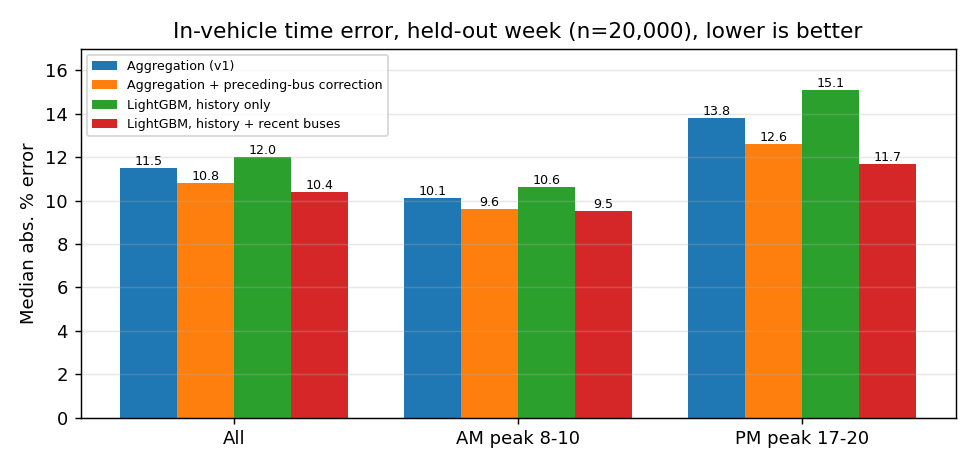

# Phase 1 試作：問題1・問題2 の作成過程と精度検証

作成日: 2026-11-15
対象: 問題1（観測 GPS にもとづくバス所要時間＋経路検索 API）と 問題2（乗車券にもとづく混雑度つき経路検索）
データ: 2026年10月のバス GPS（DTC、31日分）・電子乗車券（約256万件）・GTFS Static v32・GTFS-RT（API）。入手の詳細は [data.md](data.md)。

> 結論（先に）
> - **問題1**：区間 × 平日/休日 × 時間帯の中央値という単純なモデルで、検証週（10/25〜31）の乗車時間の誤差（中央値）は **11.5%**。GTFS 時刻表（25.9%）の半分以下。夕方ピークでは時刻表 29.4% → 13.7%。
>   待ち時間を含めた所要時間は、過去データだけでは誤差が大きい（中央値 34%）。**リアルタイムの GPS で手前のバスが見えているとき（約47%）は 15.9% まで下がる**。
> - **問題2**：乗車券の 79% を路線上の乗車・降車停留所に対応づけ、路線 × 区間 × 時間帯の車内人数を推定。平日の朝 8〜9 時・夕 18〜19 時にピーク、休日は低く平ら（既知のパターンと一致）。前の3週間から作った推定は、最後の1週間の推定と **相関 0.83（信頼度「高」）・混雑レベル一致 74〜80%・1段階以内 97%**。
> - 経路検索 API と地図の画面は動作する。ランダムな 200 組の出発地・目的地で **100% 経路あり、検索 0.13 秒（中央値）**。
> - **Google Maps との比較はまだ**（API キーが無い）。やり方は 5 章に書いた。

---

## 1. 全体の構成

```
data/raw/bus_gps/*.7z ──(scripts/gps_to_parquet.py)──▶ data/interim/bus_gps/  （GPS 5.7 GB）
GTFS stops/trips/stop_times ──(tsh.common.patterns)──▶ data/processed/patterns.parquet （路線ごとの停留所の並び）
GPS × patterns ──(tsh.passages)──▶ data/interim/stop_passages/  （どの便が何時にどの停留所を通ったか）
stop_passages ──(tsh.traveltime)──▶ data/processed/{train,all}/link_*.parquet, route_wait.parquet  ← 問題1のモデル
乗車券 × patterns × GPS ──(tsh.stopmatch)──▶ data/processed/tickets_matched.parquet （券の乗車・降車の停留所）
tickets_matched ──(tsh.crowding)──▶ data/processed/{train,test,all}/crowding.parquet         ← 問題2のモデル
両方 ──(tsh.planner + tsh.realtime)──▶ app/server.py（GET /journeys）＋ app/static/index.html（地図）
検証: tsh.validate_p1 / tsh.validate_p2 / tsh.validate_planner → results/
```

- コードは `src/tsh/`、API と画面は `app/`、検証結果は `results/`。
- **学習は 10/1〜10/24、検証は 10/25〜10/31**（時系列で分け、検証週はモデル作成に一切使わない）。画面・API は全31日で作ったモデル（`all`）を使う。
- 祝日 10/2（ガンディー生誕記念日）は休日扱い。

### 再現手順

```bash
pip install -r requirements.txt
python scripts/gps_to_parquet.py all                 # GPS を Parquet に（約20分）
PYTHONPATH=src python -m tsh.passages                # 停留所の通過を検出（約2分）
PYTHONPATH=src python -m tsh.traveltime schedule     # 時刻表（比較用）
PYTHONPATH=src python -m tsh.traveltime train        # 問題1モデル（学習期間）
PYTHONPATH=src python -m tsh.traveltime all          # 問題1モデル（全期間、API 用）
PYTHONPATH=src python -m tsh.crowding tickets        # 停留所名の照合（GPS の別名を含む。初回は約10分）
PYTHONPATH=src python -m tsh.crowding train          # 問題2モデル（学習期間）
PYTHONPATH=src python -m tsh.crowding test           # 問題2（検証期間、比較用）
PYTHONPATH=src python -m tsh.crowding all            # 問題2（全期間、API 用）
PYTHONPATH=src python -m tsh.validate_p1             # 問題1の検証（約5分）
PYTHONPATH=src python -m tsh.validate_p2             # 問題2の検証
PYTHONPATH=src python -m tsh.validate_planner        # 経路検索の網羅性
PYTHONPATH=src python -m tsh.validate_journeys livecal  # 「今すぐ出る」の 1 本目の待ちの外れ方を集める（学習期間の中だけ、約11分、16.6）
PYTHONPATH=src python -m tsh.live_excess             # → data/processed/serve/live_wait_excess.json（API の余裕を見た到着に使う）
PYTHONPATH=src python -m tsh.validate_journeys       # 経路全体の検証（前もって計画、16章）。live で「今すぐ出る」（16.5・16.6）。正解は分かれて記録された便をつないで作る（16.8）
python -m uvicorn app.server:app --app-dir . --port 8000   # http://localhost:8000
```

---

## 2. データのつなぎ方（最初に調べたこと）

| つなぐもの | 方法 | 一致率 |
|---|---|---|
| GPS の `route_id` ↔ GTFS `route_id` | そのまま | 99.8%（GTFS は上り・下りが別の route_id） |
| 乗車券の `route`（例 `8UP`）↔ GTFS `route_short_name` | そのまま | 乗車券の行の 98.2% |
| 乗車券の `vehicle_number` ↔ GPS の `vehicle_id` | そのまま | 98%（ただし乗車券の 48.5% は車両番号が空欄） |
| GPS の `trip_id`（例 `1728_21_54_1365`）↔ GTFS の `trip_id`（例 `1000_FULL_06_10`） | 形式が違い、直接はつながらない | — |

GPS の便 ID は GTFS の便とつながらないので、**GPS の点を「路線の停留所の並び」に重ねて、停留所の通過時刻を自分で作る**方針にした。

### 路線の代表パターン（`tsh.common.patterns`）
GTFS では1つの route_id に、全区間の便（FULL）と区間便（SHORT）など複数の停留所列がある。FULL の便で最も多い停留所列を代表とした。2,574 路線、平均 32 停留所・18 km。

---

## 3. 問題1：所要時間モデルの作り方

### 3.1 停留所の通過の検出（`tsh.passages`）
1. GPS の各点を、その点の route_id の代表パターンの停留所と突き合わせ、**60m 以内**の停留所を候補にする。
2. 便（日付・車両・trip_id）× 停留所ごとに、**最も近づいた点の時刻**を通過時刻とする。
3. 停留所の順番どおりに時刻が増えていない通過（GPS のずれ・同じ停留所の再通過）を除く。
4. 通過が 5 停留所未満の便は捨てる。

結果: 31日で **約3,553万件の通過・約164万便**（1日あたり約5万便）。1日2〜4秒で処理できた。

GPS の点の間隔は中央値11秒（90%点22秒、2分を超える空白は0.6%）。通過とみなした点と停留所の距離は中央値17.5m、90%点43.7m（10/15）。

**確かめる画面**（`app/viz.py`・`app/static/passages.html`、2026-11-16 追加）: `http://localhost:8000/passages` で、路線・日付・便を選ぶと次が見える。
- 地図: 路線の形（GTFS の shapes.txt）、停留所（判定で色分け：通過・近くを通ったが順番の確認で除外・60m 以内に点なし）、停留所のまわり 60m の円、その便の GPS の点（時刻で色が変わる）、通過とみなした点と停留所を結ぶ線。再生ボタンでバスの動きと停留所の通過を順にたどれる。
- 停留所ごとの表: 通過時刻、前に検出した停留所からの時間と速さ、判定。未検出の停留所は最も近い点までの距離。
- 時間・距離の図（マーレイ図）: 横が時刻、縦が始点からの距離。同じ日の全便の通過と時刻表を重ね、選んだ便は GPS の点も描く。線の傾きが速さ、線の間隔が運行間隔を表すので、渋滞（線が寝る）や団子運転（線が近づく）、時刻表とのずれが一目で分かる。
- 同じ系統の全バス（同日追加）: その日にこの系統（上り・下り）を走った全バスを、再生の時刻に合わせて地図の上で同時に動かす（青＝同じ向き、紫＝逆向き、橙＝選んだ便）。バスをクリックするとその便に切り替わり、逆向きなら路線も切り替わる。764UP（10/15）では9時に同じ向き18台・逆向き15台が走っている。時間の範囲を「1日全体」にすると5〜24時を通して再生できる。API は `GET /viz/api/fleet`（GPS を30秒おきに間引く）。
- 停留所ごとの検出率（同日追加）: その日、前と後の停留所で通過を検出した便（＝確実にそこを通った便）のうち、その停留所でも検出できた便の割合。最初・最後の停留所は率を出さない。764UP（10/15、191便）では中央値80%、70%未満が20か所。
- 規模の表示（同日追加）: 検出は1便だけでなく、10月の全体で 2,079 路線（時刻表の 2,574 路線のうち）・6,644 台・約164万便・約3,553万回の通過を検出している（`GET /viz/api/overview`）。

**検出の取りこぼし**（10/15、全路線）: 確実に通った便のうち、その停留所で通過を検出できたのは **77.3%**（路線×停留所 50,265 組の中央値 83%、50%未満の停留所が 9.7%、70%未満が 25.1%）。約4分の1の通過を取りこぼしている。所要時間は検出できた停留所どうしの間で数えるので値が偏るわけではないが、停留所ごとの時刻の材料が減る。13.3 の補間に替えれば、この率がどこまで上がるかで効果を測れる。

### 3.2 区間所要時間（`tsh.traveltime.build`）
- 同じ便で続けて検出された2つの停留所（間の未検出が4停留所まで）の時刻差を、間の「隣り合う停留所どうしの区間（リンク）」に**距離で按分**。時速 1〜80km の範囲外は捨てる。
- リンクは**停留所 ID の組**で表すので、同じ道路を走る別の路線のデータもまとめて使える（先行研究で、路線をまとめても精度はほとんど落ちないとされている）。
- **リンク × 平日/休日 × 1時間帯の中央値**を推定値とする（観測 5 件以上）。足りなければ、時間帯をまとめた値 → リンク全体 → 時速 15km の順に退避。検証では 98.8% が最も細かい値で済んだ。
- 乗車時間は、時刻を進めながらリンクを足していく（長い乗車の途中で時間帯が変わっても対応）。

学習期間の 3,135 万件のリンク観測から作成。ネットワーク全体の速度（中央値）は、平日の 18 時が最も遅く **14.2 km/h**、深夜は 30 km/h 超、休日は全体に速い。

### 3.3 待ち時間
- 最初は「便数から運行間隔を出して、その半分」にしたが、**実際の待ち時間（平均 35 分）に対して 19 分と大きく過小**だった。原因は、(1) 運行間隔が均等でない（だんご運転）、(2) GPS の便 ID が途中で切り替わり便の数を多めに数える、の2つ。
- そこで、各路線の**基準停留所（最もよく検出される停留所）での実際の到着間隔 H から、ランダムな時刻に来た人の平均待ち時間 E[H²]/(2E[H])** を、路線 × 平日/休日 × 時間帯ごとに求める方式に変えた（間隔のばらつきが自動的に入る）。これで平均の偏りはほぼ消えた（予測 31.3 分 vs 実際 35.0 分）。
- **リアルタイム**：GTFS-RT の現在位置から、乗車停留所より手前を走っている同じ路線のバスを探し、「最後の位置 → 乗車停留所」の乗車時間をモデルで足して到着時刻を出す（`tsh.realtime`）。手前にバスが見えなければ過去の実績の待ち時間を使う。

---

## 4. 問題1の精度検証（`tsh.validate_p1`、検証週 10/25〜31）

### 4.1 乗車時間（同じ便の停留所 i → j、5〜25 停留所先、20,000 区間）

| 方法 | 誤差の中央値 | 平均絶対誤差 | ±20% 以内 | 平均の誤差の向き |
|---|---|---|---|---|
| GTFS 時刻表 | 25.9% | 6.9 分 | 40.1% | 早すぎる側 |
| 観測、時間帯なし | 18.5% | 5.9 分 | 53.2% | 早すぎる側 |
| **観測 × 時間帯（本モデル）** | **11.5%** | **4.5 分** | **72.0%** | 中央値で −0.7 分 |

（実際の乗車時間の平均は 21.2 分）

| 時間帯 | 時刻表 | 時間帯なし | 本モデル |
|---|---|---|---|
| 朝ピーク 8〜10 時 | 20.1% | 13.5% | **10.0%** |
| 夕ピーク 17〜20 時 | 29.4% | 25.1% | **13.7%** |
| 平日 | 25.6% | 18.8% | **11.7%** |
| 休日 | 26.5% | 17.9% | **10.9%** |


- **時間帯を入れる効果は夕方ピークで特に大きい**（25.1% → 13.7%）。時刻表は夕方に短く見積もりすぎている（誤差の中央値で −4.5 分）。
- 本モデルは平均では少し短め（平均 −2.9 分、中央値 −0.7 分）。中央値を使っているため、たまに起きる大きな遅れが平均を引っ張る。「余裕を見た時間（85% 点など）」を別に出すのが次の改善点。
- 先行研究との比較の目安：コペンハーゲンの1路線で過去平均の MAPE 6.5%、Google のバス専用モデル（BusTr）13.2%、インドの研究は 10〜25%。**本モデルの MAPE は 17.1%**（区間の長さが違うので直接は比べられない）。

### 4.2 待ち時間込み（停留所 i にランダムな時刻に来た人が、次の実際のバスで j に着くまで、3,000 件）

| 方法 | 合計の誤差の中央値 | ±20% 以内 | 待ち時間の誤差の中央値 |
|---|---|---|---|
| 時刻表どおりの次の便 | 36.5% | 29.7% | 67.0% |
| 本モデル（過去の実績の待ち時間） | 33.9% | 30.1% | 58.7% |
| **本モデル＋リアルタイム** | **24.9%** | **42.0%** | **36.6%** |
| うち手前にバスが見えたとき（46.7%） | **15.9%** | **57.6%** | **22.1%** |

- 待ち時間は、来る時刻しだいで 0 分にも 60 分にもなるので、**過去の平均だけでは1人ひとりの待ち時間は当てられない**。実際の待ち時間の平均は 35 分と長く、デリーのバスは本数が少ない路線が多い（先行研究とも一致）。
- **リアルタイムの位置を使うと大きく改善**し、これがブリーフの「リアルタイムと過去のデータを組み合わせる」部分にあたる。
- 注意: 検証週の GPS で追えたバスだけで「実際」を作っているので、GPS の無いバスが来ていた場合は実際の待ち時間を長めに見ている可能性がある。乗車停留所 i で検出されたバスのうち、降車停留所 j まで追えたのは 68.7%。

---

## 5. Google Maps との比較（未実施・やり方）

ブリーフの評価には「Google Maps との比較」が入っているが、**Google Maps の API キーが無いため未実施**。やり方は次のとおり。
1. 検証用の出発地・目的地の組（例：300 組）と時刻を決める。
2. Google Routes API（transit モード）は**過去の日時を指定できない**（7日前まで）ので、検証する週にリアルタイムで問い合わせて結果を保存する。
3. 同じ週の GPS で「実際の所要時間」を再現し（4.2 と同じ方法）、本モデル・時刻表・Google の3つを比べる（平均絶対誤差・誤差の中央値・±5/±10 分以内の割合）。
4. 利用規約上、Google の経路を自前の地図に重ねて表示しない・学習に使わない。比較は数値と表だけにする。

---

## 6. 問題2：混雑推定の作り方（`tsh.crowding`）

1. **路線**：乗車券の `route`（例 `8UP`）を GTFS の `route_short_name` で route_id に対応づけ（98.2%）。
2. **停留所**：乗車・降車の停留所名を、その路線の代表パターンの停留所と照合（`tsh.stopmatch`、詳しくは 13.5）。最初は完全一致だけで **乗車停留所の 42% が一致しなかった**。調べると、乗車券は「Mahipal Pur」のような短い名前、GTFS は「Mahipal Pur Village / Mahipal Pur Crossing NH8」のように複数の呼び名を `/` でつないだ名前だった。ほかにも略語（Sec・Xing・Ph-III）、ヒンディー語の音写のゆれ（Shashtri / Shastri）、語順の違いがある。次の順で決める:
   - 完全一致（GTFS の名前は `/` で分けた各部分も候補）
   - 文字列の規則（両方の名前に同じ規則を当てて鍵が一致）: 略語の展開と空白の除去 → 音写のゆれを畳む → 語順をそろえる → 子音の骨格
   - 近さで選ぶ（一方向の包含、あいまい一致）。**番号のガード**: 番号・記号・停留所の種類が食い違う候補は、点数によらず捨てる（Sec-12 → Sec 10 の取り違えを防ぐ）
   - 市内の全停留所から名前で場所を引き、その路線で 400m 以内の最寄り停留所に寄せる
   - **GPS の別名**: 車両番号つきの券は、買った瞬間のバスの位置が分かる。（路線, 名前）ごとの多数決で、文字列で決まらない名前を補い、近さで選んだ停留所と食い違えば置き換える（学習期間の券だけで学ぶ）

   → **91.4% の乗車券**で乗車・降車の両方が路線上に対応（改良前 79.2%）。券の両端のうち確からしさの低い方で数えると、完全一致 61.6%・規則 11.4%・近さで選んだ 18.4%・場所で寄せた 6.9%・GPS の別名 1.7%。残りは、GTFS に路線が無い券 1.8%、片方以上の名前が照合できない券 6.6%（区間便だけが通る停留所や、GTFS に無い名前）、両端は対応したが順番が逆か同じ停留所の券 0.2%。
3. 券 1 枚の乗客（`passenger_count` 人）は、**乗車時刻の時間帯に、乗車停留所から降車停留所までの各区間に乗っていた**とみなす。
4. 路線 × 区間 × 日 × 時間帯の人数を、その時間帯に**実際に走った便の数（GPS）**で割って「1便あたり」にする。ただし GPS がその路線の便の半分未満しか見えていない路線は、GTFS 時刻表の便数を使う（GPS の便数が少なすぎると人数が過大になるため）。
5. **拡大**：ブリーフに「電子乗車券は全バス乗車券の 3〜4%」とあるので、中央の 3.5% として **×28.6**。3% と 4% の場合も幅として持つ。
6. **物理的な上限**：一様に拡大すると、ある路線では1便 700 人のような不可能な値が出た（その路線は電子乗車券の比率が平均よりずっと高いとみられる）。**1便 100 人で頭打ち**にし、該当マス（1.1%）に印を付けた。
7. **混雑レベル**（12m 車を仮定）：座れる（35人以下）／立つ（35〜60人）／混雑（60人超）。
8. **信頼度**：そのマスの推定に使った券の枚数 n で決める（ポアソン近似で相対誤差 ≈ 1/√n）。高: 30 枚以上 / 中: 10〜29 / 低: 10 未満。90% 区間も API で返す。

学習期間で 139 万マス（1,951 路線）。レベルの内訳は 座れる 87.1% / 立つ 8.6% / 混雑 4.3%（照合の改良前は 133 万マス、88.6% / 7.7% / 3.7%）。

> 7 章と 12.5 の数値は、2026-11-16 に照合を改良したあと（13.5）に計算し直したもの。改良前の値は括弧内か、git の履歴にある。

---

## 7. 問題2の検証（`tsh.validate_p2`）

車内人数の実測（自動乗客カウンタなど）は無いので、ブリーフの「既知のピーク・オフピークのパターンで確かめる」に沿って4つの面から確認した。

### 7.1 既知のパターン（時間帯別の平均車内人数）


| | 朝 8〜10 時 | 昼 12〜15 時 | 夕 17〜20 時 |
|---|---|---|---|
| 平日 | 23.9 人（改良前 21.3） | 8.8 人（8.0） | 21.2 人（18.8） |
| 休日 | 16.5 人（14.8） | 8.4 人（約 7.7） | 13.4 人（12.0） |

- 照合できる券が増えたので（79.2% → 91.4%）、同じ拡大係数（×28.6）なら人数は全体に 1 割ほど増える。形（ピークの時刻と高さの比）は変わらない。

- 平日は朝 8 時・夕 18 時にはっきりしたピーク、休日は低く平ら。一般に知られている通勤パターンと一致する。
- 深夜 1 時に小さな山がある。夜行便は便数が少なく、少しの券で値が大きく出るため（信頼度「低」）。

### 7.2 時間的な安定性（前の3週間で最後の1週間を当てる）

学習期間（10/1〜24）の推定と、検証期間（10/25〜31）だけで作った推定を、同じマスどうしで比べた（検証側も 5 枚以上の券があるマスのみ）。

| 信頼度 | マス数 | 相関 | 順位相関 | 誤差（人） | レベル一致 | 1段階以内 |
|---|---|---|---|---|---|---|
| 高 | 180,364 | **0.83** | 0.84 | 10.9 | 73.4% | 97.8% |
| 中 | 146,239 | 0.72 | 0.78 | 10.8 | 77.8% | 96.6% |
| 低 | 34,078 | 0.62 | 0.71 | 21.1 | 67.5% | 89.5% |
| 全体 | 360,681 | 0.77 | 0.77 | 11.9 | 74.6% | 96.5% |

- **信頼度が高いほど再現性が高い**ので、信頼度の付け方は意味がある（「低」は誤差が約2倍）。
- 照合の改良で、比べられるマスが 32.0 万 → 36.1 万、信頼度「高」のマスが 15.4 万 → 18.0 万に増えた。相関はほぼ同じ（全体 0.771 → 0.765）。券が増えて上の段に移ったマスは、もともと境目にあったマスなので、段ごとの値はわずかに下がる。

### 7.3 全体量の整合
- 電子乗車券の乗客は1日平均 **88,826 人**、×28.6 で **約254 万人/日**。公表値（DTC＋クラスター、2023年）**約414 万人/日**の 61%。
- 差の 4 割は、乗車券を買わない乗客（定期券・女性の無料乗車）と考えると説明がつく。**拡大係数の決め方が推定人数の水準を大きく左右する**ので、これは今後の最大の課題（路線・時間帯ごとの捕捉率の違いも含めて）。

### 7.4 停留所の対応づけが正しいか（GPS で独立に確認）
車両番号のある券（約19万件）で、**発券時刻のそのバスの GPS 位置**と、名前から対応づけた乗車停留所の距離を測った。

| 対応づけの方法（券の両端のうち確からしさの低い方） | 件数 | 距離の中央値 | 300m 以内 | 1km 以内 |
|---|---|---|---|---|
| 完全一致 | 117,475 | 207 m | 63.8% | 94.6% |
| 文字列の規則 | 19,744 | 205 m | 64.1% | 94.3% |
| GPS の別名 | 3,306 | 175 m | 69.3% | 95.6% |
| 近さで選んだ（包含・あいまい一致） | 34,331 | 212 m（改良前 224 m） | 63.2%（60.5%） | 93.8%（91.8%） |
| 場所で寄せた | 12,782 | 248 m（238 m） | 56.9%（59.0%） | 92.2%（92.4%） |
| 全体 | 187,638 | 210 m（212 m） | 63.3%（62.9%） | 94.3%（93.9%） |

- 乗客の多くは乗った直後に買うので（13.1）、数百 m のずれは自然。
- **この距離の確認では、隣の停留所との取り違え（Sector 10 と Sector 12 など、近くにある別の停留所）は見分けられない。** 改良前は「あいまい一致も完全一致とほぼ同じ精度」と書いたが、GPS の多数決で停留所そのものを比べると、改良前のあいまい一致は 84% しか合っていなかった（13.4）。改良後の照合の正しさは 13.5 の表を見る。

### 7.5 平日朝ピークで最も混む区間（信頼度「高」）
`results/p2_top_segments_weekday_am.csv`。例：858DOWN（Najafgarh → Ajmeri Gate）Dhaula Kuan 9 時、129DOWN（Jhingola Village → 旧デリー駅）Sanjay Gandhi Transport Nagar 10 時、894UP（Okhla Village → Karampura）Taimur Nagar 8 時。郊外から都心や業務地へ向かう朝の路線が多く、向きとしては妥当。上位はどれも 1 便 100 人の頭打ちにかかっているので、並び順に意味は無い（照合の改良前の例は 258DOWN・227ADOWN・822DOWN）。

---

## 8. 経路検索 API と画面（`tsh.planner`・`app/`）

- `GET /journeys?from=lat,lng&to=lat,lng&depart=2026-11-17T08:30&sort=fastest|comfort|fewer_transfers&realtime=true`
- 到着時刻を指定するときは `depart` の代わりに `arrive=2026-11-17T09:30`（過去の同じ種類の日の 85% で間に合う最も遅い出発を返す。16.9）。`sort=fewer_transfers` は乗り換えが少ない順（16.9）。
- 出発地・目的地から徒歩 800m 以内の停留所を集め、直通と乗り換え1回の候補を探す。距離ベースの概算で上位 40 に絞り、モデルで計算し直す。
- 各候補に、徒歩・待ち・乗車の時間、**14 時に乗った場合の乗車時間**（交通の影響を見せる）、**時刻表の乗車時間**、各乗車区間の**混雑レベル・推定人数・90% 区間・信頼度**を付ける。
- `sort=comfort` は体感時間（乗車時間 × 座れる 1.0 / 立つ 1.5 / 混雑 2.3、待ち・徒歩 × 1.5）で並べる。重みは、英国の研究のメタ分析（立って乗ると座る時間の約2倍に感じる）を参考にした。
- 出発が今から 15 分以内なら、最初のバスの待ち時間を GTFS-RT のリアルタイム位置から出す（`wait_source: リアルタイム`）。2026-11-15 20:14 IST に動作を確認。
- ブリーフの例（カシミーリー・ゲート ISBT → ネルー・プレイス、火曜 8:30）: 425UP 直通、徒歩 5.7 分＋待ち 11.7 分＋乗車 56.8 分＝約 74 分、座れる（約 21 人、信頼度 高）。
- 網羅性（`tsh.validate_planner`）：3〜15km 離れたランダムな 200 組で **100% 経路あり**、乗り換えなし 35.5%、全区間で混雑度が分かる 81.5%、**検索時間 0.13 秒（中央値）・0.23 秒（90% 点）**。ドアツードアの平均速度は 7.6 km/h。

---

## 9. 限界と次にやること

**問題1**
- Google Maps との比較（5 章）。API キーが必要。
- 中央値なので平均では短め。85% 点など「余裕を見た時間」を併記する。
- 停留所での停車時間を区間に含めて扱っている。乗り換えの徒歩は直線距離 × 1.3 で、道路網（OSM）を使っていない。
- GTFS-RT を記録し始めれば、リアルタイム予測の精度を本番のデータで検証できる。

**問題2**
- 拡大係数（3.5%）の根拠が弱く、全体量は公表値の 6 割。路線・時間帯ごとの捕捉率を推定できれば改善する（例：車両番号つきの券と GPS の便で、便ごとの券の割合を見る）。
- 乗客は乗車した時間帯のまま全区間に乗っているとみなしている（長い乗車では後ろの区間の時間帯がずれる）。
- 定員は 12m 車で一律の仮定。車両の種類（電気バス `DL51EV…` など）で変えられると良い。
- 券の 21% は路線上の停留所に対応づけられていない（区間便の停留所）。代表パターン以外の停留所列も使えば増やせる。
- 定期券・無料乗車の乗客の乗り方が、券を買う乗客と同じとみなしている。

**共通**
- 10月だけのデータなので、季節・祭り（10月はお祭りの時期）の影響は分けられていない。

---

## 10. 精度改善の実験（2026-11-16）

先行研究（`reports/`・`research_notes/`）と追加の文献検索をもとに、改善策を1つずつ足して**最初の検証と同じ 20,000 区間・同じ検証週**で比べた。調整（パラメータ選び）には検証週を使っていない。

### 10.1 試したことと根拠

| 手法 | 根拠 | スクリプト |
|---|---|---|
| 時間帯を 30 分刻みにする | ピークの立ち上がりを捉える | `tsh.improve_p1`（V1） |
| 縮小推定（観測の少ないマスを上の階層に寄せる） | 経験ベイズ。BusTr でも疎な場所は粗い単位に退避 | `tsh.improve_p1`（V2） |
| 路線別のリンク時間（全路線の値に縮小） | 急行と各停で同じ道路でも時間が違う | `tsh.improve_p1`（V3） |
| **直前のバスによる補正**：出発前 30 分に同じリンクを走った他のバスが「いつもより何倍遅かったか」の中央値で補正 | デリーの TCS 論文（直前のバスの区間時間）、チェンナイの Kalman 法、Schwinger らの「先行車両＋Kalman」 | `tsh.improve_p1`（V4） |
| **機械学習（LightGBM）**：「いつもより何倍遅いか」を、時刻・曜日・リンク長・過去の値・路線別の値・直近のバスの状況から予測 | コペンハーゲン・BusTr など、機械学習の上積みは当日のリアルタイム情報によるところが大きい | `tsh.ml_p1` |
| 問題2：区間を通る時刻で数える（問題1のモデルで乗車後の経過時間を足す） | 長く乗る人の後ろの区間は次の時間帯になる | `tsh.improve_p2`（B1） |
| 問題2：縮小推定（前後2区間の率に寄せるポアソン・ガンマの経験ベイズ） | 車内人数は区間ごとに滑らかに変わる。PIPE、Rahbar らのベイズ的な較正 | `tsh.improve_p2`（B2） |

### 10.2 問題1の結果



| 方法 | 誤差の中央値 | 平均絶対誤差 | ±20% 以内 | 朝ピーク | 夕ピーク |
|---|---|---|---|---|---|
| 集計（最初の版） | 11.5% | 4.49 分 | 72.1% | 10.1% | 13.8% |
| 30 分刻み | 11.5% | 4.48 分 | 72.0% | — | — |
| 縮小推定 | 11.5% | 4.48 分 | 72.0% | — | — |
| 路線別 | 11.4% | 4.43 分 | 72.7% | — | — |
| 集計＋直前のバス補正 | 10.8% | 4.20 分 | 74.5% | 9.6% | 12.6% |
| LightGBM（過去のみ） | 12.0% | 4.66 分 | 70.7% | 10.6% | 15.1% |
| **LightGBM（過去＋直近のバス）** | **10.4%** | **3.92 分** | **76.6%** | **9.5%** | **11.7%** |

分かったこと:
- **区切り方を細かくする・縮小推定・路線別はほぼ効かなかった**。31日分のデータがあり、ほとんどのマスで観測が十分（98.8% が最も細かいマスで推定できていた）なので、疎なマスの扱いを工夫する余地が小さい。
- **効いたのは「直前のバスの実績」だけ**。集計方式でも機械学習でも、直近のバスの情報を入れると誤差が下がった。特に夕ピーク（13.8% → 11.7%）で効く。LightGBM の特徴量の重要度でも、「同じリンクの直近の状況」が最も大きかった。
- **機械学習は、過去のデータだけだと集計方式に負けた**（12.0% vs 11.5%）。直近のバスの情報を入れると最も良くなった（10.4%）。先行研究（コペンハーゲン：過去平均と Google がほぼ同じ、深層学習の上積みは当日情報から）と同じ傾向。
- 最初は機械学習のほうが過去の値を 17 日分しか使えない条件で比べていて不利だった（過去のみ 13.9%、過去＋直近 11.0%）。学習する日を除いた残りの日から過去の値を作る「1日抜き」にして、24 日分を使える同じ条件にそろえた結果が上の表。

### 10.3 問題2の結果

前の期間の推定で後の期間を当てる検証（最初の検証と同じ条件、後の期間で券が 5 枚以上あるマス）:

| 方法 | 相関 | 誤差（人） | 混雑レベル一致 |
|---|---|---|---|
| 最初の版 | 0.768 | 12.05 | 75.1% |
| 縮小推定（α=2、10/1〜17→10/18〜24 で選択） | 0.768 | 12.04 | 75.1% |
| 区間を通る時刻で数える | 0.769 | 12.78 | 74.2% |

（13.5 の照合の改良のあとに計算し直した値。改良前は順に 0.775・11.66・76.5%、0.775・11.65・76.5%、0.773・12.44・75.3% で、結論は同じ）

- **どちらもほぼ効果なし**。縮小推定は券の少ないマスに効く方法だが、この検証は券が 5 枚以上のマスだけで比べているので差が出にくい。時刻の補正は、後の期間の側も同じ補正で作っているので、良し悪しをこの検証では判定しにくい。
- 問題2の本当の弱点は、この検証では測れない**系統的な誤差（電子乗車券の捕捉率 3.5% の仮定、路線ごとの捕捉率の違い）**。精度を上げるには、実測（乗客を数えたデータ）か、路線別の利用者数の公表値が必要。

### 10.4 Colab・深層学習について
- LightGBM は GPU 不要で、この PC（20 コア・32GB）で学習 30 秒程度。Colab は使っていない。
- 深層学習（区間の並びをまとめて読む LSTM など）は、GPU のある Colab で試せるが、学習データを Google ドライブにアップロードする必要がある（Delhi Transport Stack の利用規約の範囲か確認が必要）。上の結果からは、上積みの大部分は「直近のバスの情報」から来ており、モデルを複雑にする効果は小さいと見込まれる。

### 10.5 まだ経路検索 API に入れていないもの
- 直前のバス補正と LightGBM は、**本番では GTFS-RT を記録し続けて「直近 30 分のリンク観測」を作る必要がある**。今の API は過去の実績の表と、最初のバスの待ち時間のリアルタイム推定だけを使っている。GTFS-RT の記録の仕組みを作れば、API に組み込める。

---

## 11. GTFS-RT の記録と、経路検索への「直前のバス補正」の組み込み（2026-11-16）

10章で効果が確認できた「直前のバスによる補正」を本番の経路検索で使うには、直近 30 分の実際の区間時間が必要。GTFS-RT は過去分が配布されないので、自分たちで記録する仕組みを作った。

### 11.1 記録（`tsh.recorder`）
- 20 秒ごとに GTFS-RT（VehiclePositions）を取得し、車両ごとに前回より新しい GPS 点だけを残す（同じ点の重複を防ぐ）。
- 60 秒ごとに `data/raw/gtfs_rt/date=YYYY-MM-DD/part-HHMMSS.parquet`（IST の日付）に保存。取得に失敗しても止まらず、間隔を延ばして再試行する。
- 起動: `powershell -ExecutionPolicy Bypass -File scripts\start_recorder.ps1`（または `PYTHONPATH=src python -m tsh.recorder`）。ログは `data/raw/gtfs_rt/recorder.log`。
- 2026-11-15 21:35 IST（夜）の取得で、1回あたり約 3,800 台・約 410 KB。
- 記録データは Delhi Transport Stack の利用規約の対象なので、`data/` 以下に置き、コミットしない。

### 11.2 直近の区間実績（`tsh.livelinks`）と経路検索への組み込み
- 直近 75 分の記録を読み、検証と同じ方法で「停留所の通過 → 隣り合う停留所の区間の時間」に変換し、過去の推定との比（log）を持っておく（60 秒ごとに更新）。
- 経路検索で、乗車が今から 15 分以内なら、これから乗る区間の直近 30 分の log 比の中央値 r と件数 m から、乗車時間 × exp(r)^(m/(m+20)) で補正する（10章の V4 と同じ式）。
- API の返り値に、各乗車区間の補正係数 `ride_live_factor` と使った観測数 `ride_live_obs`、全体の状況 `live_links` を追加。状況だけを見る `GET /live` も追加。
- 補正が効くのは、記録を 30 分以上続けて、乗る区間を最近ほかのバスが走っているとき。記録を始めた直後や深夜は観測が少なく、補正係数はほぼ 1（補正なし）になる。

### 11.3 まだやっていないこと
- 記録は、この PC の Windows にログインしている間だけ続く。ログイン時に自動で始まるよう、スタートアップフォルダにショートカット「TSH GTFS-RT recorder」（`powershell -WindowStyle Hidden -File scripts\start_recorder.ps1`）を置いた（2026-11-16）。止めたいときはタスクマネージャーで該当の python を終了し、自動起動をやめるならショートカットを削除する。
- 二重起動の防止: 記録はローカルのポート 47811 を確保できたときだけ動き、2つ目は「すでに記録が動いているので終了します」と出して終わる。
- PC がスリープ中や電源オフの間は記録されない。期間中ずっと記録するなら、クラウドの小さなサーバーで動かすのが確実。
- LightGBM（10章で最も良かった 10.4%）は API にはまだ入れていない。今は集計＋直前のバス補正（10.8%）を使っている。
- 記録が数日分たまれば、本番のデータでリアルタイム補正の精度を検証できる（10章と同じ方法）。

---

## 12. さらなる精度改善：リサーチと実験（2026-11-16）

### 12.1 リサーチ
5 分野（乗車時間予測・待ち時間と次のバス・部分的な乗車券からの混雑推定・経路検索の評価・デリーの運行と乗車券の事実）を文献とデリーの公表資料で調べた。
- 報告書: [`reports/所要時間と混雑推定の精度改善策.md`](../reports/所要時間と混雑推定の精度改善策.md)（元のノートは `research_notes/所要時間と混雑推定の精度改善策/`）
- 特に効いた事実: 女性の無料乗車が乗車の約 42%（経済調査 2025-26）で電子乗車券に入っていない／電子乗車券は全乗車の約 2.2%・有料乗車の約 3.75%／9m 電気バス（DEVI）の定員は 36 人（座席 23）／待ち時間は「情報なし」の予測では誤差 4〜6 割が下限。

以下、検証の条件はこれまでと同じ（学習 10/1〜24、検証 10/25〜31。調整は検証週を使わずに行うか、事前に決めた値を使う）。

### 12.2 問題1：乗車時間（`tsh.seg_ml`）
乗る区間全体（停留所 i → j）を 1 つの学習例にした LightGBM（区間型）を追加した。リンクごとに予測して足すと、評価している区間全体の誤差とずれるため（文献でもリンクの中央値の合計は短めに偏るとされる）。過去の推定は 1 日抜きで作り、直近の特徴量は「これから通るリンク・手前 10 リンク・同じ路線・市内全体の直近 30 分の“いつもとの比”」。

| 方法 | 誤差の中央値 | 平均絶対誤差 | 平均の偏り | 偏りの中央値 |
|---|---|---|---|---|
| 集計（最初の版） | 11.5% | 4.49 分 | −2.92 分 | −0.74 分 |
| 集計＋直前のバス補正（10章） | 10.8% | 4.20 分 | −2.51 分 | −0.62 分 |
| リンク型 LightGBM（10章） | 10.4% | 3.92 分 | −2.26 分 | −0.55 分 |
| **区間型 LightGBM（過去＋直近）** | 10.4% | **3.82 分** | **−1.48 分** | **±0.01 分** |
| **リンク型と区間型の平均（重み 0.5、事前に決定）** | **10.0%** | **3.78 分** | −1.90 分 | −0.25 分 |

**余裕を見た時間（85% 点）**: 分位点回帰で 15%・85% 点も出した。実際に 85% 点以内に着いた割合は **85.1%**（直近あり）／83.2%（過去のみ）、15〜85% 点に入った割合は 68.6%／70.8% で、狙い（85%・70%）どおりに較正されている。85% 点は中央値より平均 4.7〜5.3 分長い。

### 12.3 問題1：待ち時間（`tsh.improve_wait`）
最初の検証と同じ 3,000 件で比較（`results/p1_wait_final.json`）。

| 方法 | 待ち：誤差の中央値 | 待ち：平均絶対誤差 | 合計：誤差の中央値 | 合計：平均絶対誤差 |
|---|---|---|---|---|
| 過去の実績 | 58.7% | 23.2 分 | 33.9% | 24.7 分 |
| リアルタイム（手前のバス、今の API） | 36.6% | 17.4 分 | 24.9% | 21.0 分 |
| 前のバスからの経過で条件づけ | 60.2% | 23.9 分 | 33.8% | 25.0 分 |
| リアルタイム → 経過で条件づけ | 35.8% | 17.4 分 | 24.2% | 20.9 分 |
| リアルタイム＋折り返し（最も早い到着） | 34.5% | 19.0 分 | 24.6% | 22.6 分 |
| 確率的な組み合わせ（失敗） | 47.4% | 20.3 分 | 29.7% | 24.3 分 |
| **リアルタイム → 折り返しと経過の平均 → 経過（採用）** | **33.3%** | **16.8 分** | **23.5%** | **20.3 分** |

- **折り返しの予測**: 車両ごとの便の並びから「路線 A の次に走る路線 B」を学ぶと、**75.6% は反対方向の同じ路線**、終点での休憩は中央値 10.2 分だった。反対方向から折り返してくるバスも候補に入れると、「次のバスが見えている」割合が **46.7% → 82.0%** に上がった。ただし折り返しは確実ではない（別の路線に入る・休憩が長い）ので、それだけを使うと平均誤差が悪化した。
- **予測の組み合わせ**: 折り返しの予測（中央値で偏りなし・ばらつき大）と経過時間の予測（短めに偏る）を半々で平均すると、手前のバスが見えないが折り返しがある場合（1,059 件）の誤差の中央値が 47〜49% → 41.6%、偏りがほぼ 0 になった。重みは事前に決めた 0.5 で、検証データでは調整していない。
- **失敗**: 候補ごとに「来る確率」を付けた確率的な組み合わせは、見えていないバスを「ランダムに来る」とした仮定が楽観的すぎ、短めに大きく偏った。

**見えているバスの到着予測の精度（予測の先の長さ別、`results/p1_eta_by_horizon.json`）**

| 何分先 | ±2 分以内 | ±5 分以内 | 誤差の中央値 |
|---|---|---|---|
| 5 分未満 | 70.6% | 84.7% | −0.4 分 |
| 5〜10 分 | 64.4% | 86.2% | −0.5 分 |
| 10〜20 分 | 40.4% | 68.4% | −1.4 分 |
| 20〜30 分 | 26.3% | 52.1% | −2.6 分 |
| 30〜60 分 | 20.5% | 37.3% | −2.2 分 |

10 分先までは海外の公表値（ストックホルム：±1 分以内 64%）と同程度。

### 12.4 経路全体の再現検証（`tsh.validate_journeys`）
> **2026-11-18 訂正**: この節の数字は、再現が出発の 5.5 時間前の時間帯で行われていた不具合による値。直した後は、本モデル 20.3%・時刻表 24.3%（この節と同じ待ち時間の方式）。詳しくは 16 章。

ハッカソンの評価「代表的な出発地・目的地の組で、実際の所要時間と比べる」に合わせ、3〜15km 離れた 600 組・検証週の 7〜21 時の出発で、学習期間だけのモデル（前もって計画する場合、直近の実績なし）で経路を検索し、候補の上位 3 案を検証週の GPS で「実際に来たバスに乗ったら」と再現した（Berkeley の SF 研究と同じ考え方）。

| | 本モデル | 時刻表 |
|---|---|---|
| 1 位の案の合計時間：誤差の中央値 | **35.5%** | 43.0% |
| 平均絶対誤差 | **49.9 分** | 63.0 分 |
| ±15 分以内 | **35.2%** | 23.5% |
| 平均の偏り（−は短く予測） | −39.3 分 | −32.2 分 |
| 1 位の案が実際に最速だった割合（再現できた案が 2 つ以上の 207 組） | 62.3% | 61.8% |
| 1 位の案と実際の最速との差（平均） | 13.9 分 | 15.5 分 |

- 1 位の案を GPS で最後まで再現できたのは 264 組（44%）。乗換ありの案は実際の平均が 140 分と長く、誤差が大きい。
- **全体として短めに大きく偏る**。候補（約 40 案）の中で予測時間が最も短い案を選ぶので、たまたま待ち時間を短く見積もった案が選ばれやすい（「勝者の呪い」）。
- **補正の失敗**: 乗換回数ごとの倍率（予測 × 1.14〜1.42）で補正すると平均の偏りは減ったが、誤差の中央値は 35.5% → 37.9% に悪化した（2 分割の交差検証）。大半の案は予測どおりで、一部が大きく遅れる（1 時間来ない等）分布のため、全体を伸ばすと普通の案まで外れる。
- 次の手: 順位づけに「余裕を見た時間（待ち時間のばらつきを含む）」を使う信頼性重視の経路選択（文献では時間どおりに着く割合が 5〜11 ポイント上がる）と、直近の実績を使う出発（ここでは使っていない）。

### 12.5 問題2：混雑（`tsh.p2_trip`、`tsh.crowding2`）

**便ごとの検証（初めての“便単位”の予測検証）**: 車両番号つきの券（約 52%。路線・時間帯によらずほぼ一定なので、ほぼ無作為な半分とみなせる）を GPS の便に結びつけた（**90.1%**、約 109 万枚。照合の改良前は約 95 万枚）。便 × 区間ごとに「乗っていた券の人数」を作り（4,426 万行、券の無い便も 0 として数える）、10/1〜24 から作った推定で 10/25〜31 を予測した。

| 方法 | ポアソン逸脱度（小さいほど良い） | 相関 |
|---|---|---|
| 今の方式（全券の人数 ÷ 便数） | 0.839 | 0.474 |
| 便ベースのマス平均（縮小なし） | 0.962 | 0.531 |
| **便ベース＋縮小推定（α=30、10/1〜17→10/18〜24 で選択）** | **0.792** | **0.533** |

週ごとの比較（10 章）では見えなかった縮小推定の効果が、便単位の検証ではっきり出た（逸脱度 −5.6%、相関 0.47 → 0.53）。照合の改良で正解の人数そのものが増えた（券のある便 × 区間 17.1% → 19.1%）ので、逸脱度の値は改良前（今の方式 0.776 → 縮小推定 0.734、−5.4%）とは直接比べられない。方法どうしの差は改良前と同じ。

**便ごとのばらつき**: 本当の車内人数の便ごとの変動係数は全体で 1.14、混む区間でも 0.76。平均が「座れる」でも、かなり混む便がある。

**改良版の推定（`tsh.crowding2`）**:
1. 拡大係数を分解: 全乗客 = 照合できた券（91.4%） × 1/(有料乗客に占める電子乗車券 3〜4%) × 1/(1 − 無料乗車 33〜51%)。幅は 41〜74 倍（中央 50 倍、旧 28.6 倍。照合の改良前は 79.2%・47〜86 倍・中央 58 倍）。
2. **路線ごとの拡大係数**: 一律に 58 倍すると、マスの **21%** で平均が定員の 1.5 倍を超えた（物理的に無理。照合の改良前に測った値）。電子乗車券の割合が高い路線ほど拡大しすぎる。そこで「その路線の混む区間（95% 点）が定員 × 1.4 を超えない」上限 U_r を設け、E_r = min(E*, U_r)。E* は前提の幅の中で公表総数に最も近づく値（上限の 74.4 倍）。
   - 上限にかかった路線は 1,971 中 1,194。拡大後の合計は公表値の **約 76%**（照合の改良前 73%、旧方式 61%）。**定員と矛盾せずに公表総数（約 408 万人/日）に合わせることはできなかった** → 混む路線では電子乗車券の割合が 3.75% より高い。路線別の乗車総数（ETM の集計）が無いと、これ以上は決められない。
   - 定員の 1.5 倍を超えるマス: 21%（一律 58 倍） → **4.4%**。
3. **車種別の定員**: CNG 12m（座席 40・定員 64）、電気 12m（39・63）、電気 9m（23・36）。車両番号から 12m と 9m は区別できなかった（1 台あたりの券の人数でも分からない）ので、電気バスは台数比で混ぜる。路線ごとの CNG と電気の割合は GPS から。
4. **混雑の確率**: 車内人数をガンマ分布（平均 μ、変動係数は平均の大きさ別）とし、推定の不確かさも足して P(座れる)・P(立つ)・P(混雑) を出す。見出しのレベルは平均と、車両構成で重みづけした座席数・定員の比較。
   - レベルの内訳（券 5 人以上のマス）: 旧 座れる 73% / 立つ 17% / 混雑 11% → 新 54% / 26% / 19%。平日の平均車内人数は朝ピーク 30.7 人、昼 13.2 人、夕ピーク 24.8 人（照合の改良前は新 53% / 27% / 20%、29.5・12.5・23.6 人）。

### 12.6 API・画面に入れたもの
- 乗車時間: 区間型 LightGBM（`tsh.segmodel`）。中央値と **85% 点（余裕を見た時間）**、「余裕を見た到着」（`arrive_safe`）。乗車が今から 30 分以内で記録した GTFS-RT があれば「直近あり」のモデル。
- 待ち時間: 12.3 の採用方式（`tsh.waitmodel`）。待ち時間の出どころ（手前のバス／折り返し＋経過／前のバスが何分前に通過）を表示。
- 混雑: 改良版（`tsh.crowding2`）。確率・平均人数・信頼度を表示。券が無い区間は「不明」。
- 検索時間は 1〜4 秒程度に増えた（起動直後の最初の検索は 10 秒以上）。
- 経路の再現検証（12.4）用に、学習期間だけで作った表で動く設定（`SegModel(train_only=True)`）も用意。

### 12.7 効かなかったこと・限界
- 30 分刻み・縮小推定・路線別（リンク単位）、週ごとの比較での混雑の縮小推定・時刻補正（10 章）。
- 前のバスからの経過時間だけでの条件づけ（効果ほぼなし）、確率的な組み合わせ、経路全体の倍率補正。
- 9m 電気バスの車両番号を特定できない。混雑の水準（拡大係数）は公表総数と定員の両方を満たせない。
- 経路全体の再現は、GPS で最後まで追えたバスだけで作っているので、実際の待ち時間を長めに見ている可能性がある。

### 12.8 次にやること（優先順）
1. **データの依頼**: Transport Stack／DTC に、ETM（車掌端末）と Pink Saheli カードの「路線 × 時間帯 × 券種」の集計を 1 か月分依頼する。拡大係数を路線ごとに決められ、混雑の水準の誤差が大きく減る。
2. **Google との比較**: 10 月の検証週は Google の API で問い合わせできない（過去は 7 日前まで）。記録中の GTFS-RT の新しい週を検証週にし、その週に Routes API（transit）で同じ出発地・目的地・時刻を問い合わせて保存する。
3. **信頼性重視の経路選択**: 待ち時間のばらつきを含む「余裕を見た時間」で順位づけし、12.4 の再現検証で 1 位の的中率と偏りが改善するか確かめる。（2026-11-18: 16.3 で、日ごとの再現の中央値で選ぶ方式を入れた）
4. **GTFS-RT の記録を数日〜1 週間ためて**、直近の実績を使う乗車時間・待ち時間を本番のデータで検証する。

## 13. データの読み解き：乗車券の正体と、停留所の照合・通過検出の見直し（2026-11-16）

リサーチ2本（[`reports/デリーのバス乗車券の電子購入.md`](../reports/デリーのバス乗車券の電子購入.md)、[`reports/停留所名の照合と通過検出.md`](../reports/停留所名の照合と通過検出.md)）と、手元のデータでの確認。

### 13.1 乗車券データの正体
- 配布された CSV は、ONDC のバス販売側システムの公開コード（[`transport-stack/ondc-buses-seller`](https://github.com/transport-stack/ondc-buses-seller)、`main/models/tickets.py` の `Ticket`）の表の抜き出しとみられる（列名が一致）。元の表には **`start_stop_code`・`end_stop_code`（停留所コード）と `subscriber_id`（購入アプリ）** もあるが、配布データには無い。
- 入っているのは**アプリで買った有料の片道券だけ**（1人あたりの金額の 99.3% が正規運賃のちょうど 0.9 倍＝アプリの 10% 割引）。車掌の発券機（現金・UPI・カード）、Pink Saheli カードのタッチ、定期券は入らない。
- `vehicle_number` は購入アプリが最初の要求で送ったバス番号を写しただけで、販売側は補わない。**空欄は「バスを指定しない買い方」（系統と停留所を選ぶ方式：WhatsApp、Chalo、Chartr の Route-based ticketing など）の印**で、欠損ではない。
- 空欄の券も番号つきの券とほぼ同じタイミングで買われている（10/13〜16、各約13万枚。直前のバスの通過から3分以内の購入が 56.9% と 53.1%、直前の通過の方が近いのが 66.4% と 65.4%）。**空欄の券も大半は乗った直後に車内で買われている。**
- **乗ってから買う**ことを、車両番号つきの券で同じ車両の GPS と突き合わせて確かめた（10/13〜16、両端が名前の完全一致の券 111,955 枚、`experiments/ticket_gps/purchase_timing.py`）。
  - そのバスが乗車停留所を通った時刻（60m の最近点）から見た購入時刻: 中央値 **0.8 分後**（四分位 0.1〜1.3 分後）。通過の 0〜2 分後が 65.4%、2〜5 分後 9.5%、5 分より後は 2.7%。通過の 0〜2 分前が 16.1%、2 分より前は 6.3%（通過を検出できた 77,633 枚）。
  - 購入の瞬間（直前60秒以内の GPS の点）にバスの最寄りだった停留所: 乗車停留所 **66.6%**、1つ先 22.0%、2つ以上先 3.7%、まだ手前 7.7%（96,801 枚）。
  - つまり大半は、乗った直後、バスがまだ乗車停留所か次の停留所までの間にいるうちに買っている。通過の直前の購入は、停留所での停車中（通過時刻は最も近い点の時刻なので、停車の終わり側に出ることがある）に買ったものを含むとみられる。2分より前の購入（6.3%）は、停留所で待ちながら近づくバスを選んだか、乗車停留所の選び間違い。
  - 販売側の券はバスを指定しなくても発行され、翌日午前3時まで有効なので、停留所で先に買うことはできる。それでも実際には乗ってから買う人が大半。
- **10/17 11:45〜10/19 10:00 は空欄の券だけが平常の約4分の1に減った**（空欄を生むアプリか機能の停止とみられる）。量を比べる分析ではこの期間を外す。**10/20 はダシャラーの祝日**で、両方の券が日曜並みに減っている（今の `HOLIDAYS` は 10/2 だけ）。

### 13.2 停留所名の照合
- 照合できない券の約9割は、GTFS の `fare_stage` の印が無い路線（券の 59%）に集まる（印あり：完全一致 88.8%・照合できず 4.8%、印なし：32.9%・31.4%）。
- 今の rapidfuzz 85 点のあいまい一致は、番号や1文字だけ違う停留所を取り違える（Dwarka Sec-21 → Sec 9、A1 → C1 など）。
- 路線の停留所に限った段階的な照合（略語の展開と空白の除去 → 音写のゆれを畳んだ鍵 → 語順 → 子音の骨格 → 一方向の包含 → 番号のガードつきのあいまい一致）で、**片方でも照合できない券が 23.6% → 11.7%**（退避の前、目視の抜き取りのみ）。実験スクリプトは `experiments/stop_name_matching/`（コミットしていない）。→ GPS で確かめて段階を選び直し、13.5 で本体に入れた。
- 最優先は運営に停留所コードを頼むこと（手に入れば名前の照合が要らなくなる）。

### 13.3 GPS からの通過の検出
- `timestamp` は GPS の観測時刻なので、配信の遅れは通過時刻に入らない。
- 60m 以内の最も近い点を使う今の方法の時刻の誤差は小さい（11秒おきで標準偏差約3秒）。問題は、点の間隔が開くと速いバスの通過を取りこぼすこと、起点・終点での待機の混入、順番の確認で1つの外れ値から後ろがまとめて消えることにある。
- 勧める方法は、GTFS の shapes.txt の線に点を前方の窓で投影し、停留所の距離を挟む2点の時刻を補間して、到着と発車を分けること。効果は点の間引き実験と `/passages` の画面で確かめる。

### 13.4 GPS で停留所名を推定する（別名の学習と、今の照合の点検）
車両番号つきの券は、買った瞬間のバスの位置が GPS でわかる。乗客の大半は乗った直後に買うので（13.1）、同じ（路線, 乗車名）の券を集めて投票すれば、名前の文字列を見ずにその名前がどの停留所かを推定できる（`experiments/ticket_gps/alias_from_gps.py`、10月全体、位置が取れた券 956,313 枚）。
- ずれの分布（購入時のバスの最寄りの停留所 − 乗車停留所）: 同じ停留所 65.1%、1つ先 23.0%、1つ手前 5.5%、2つ先 2.4%。投票はこの分布で重みを付ける。
- **確かめ**: 完全一致の名前を隠して当てると、10枚以上の組で 89.3%（±1停留所 98.9%）、10枚以上かつ首位と2位の差 0.3 以上の組（38%）で **97.8%**。起点・終点の停留所は当たりにくい（83.5%）。
- **今の照合の点検**: GPS の推定と一致するのは、完全一致 97.8% に対し、**あいまい一致 83.6%**・距離での退避 85.0%。食い違いの多くは番号・1文字の取り違え（R.K. Puram Sec-12 → Sec 10、Dwarka Sec 1 → Sec 13、Saket A Block → M Block、Uttam Nagar Terminal → Tilak Nagar Terminal など）。
- **補う**: 今は照合できない乗車名のうち 722 組（10枚以上・差0.3以上）が決まり、車両番号のない券や降車名にも同じ鍵で使うと、未照合の端が **10.6% → 7.6%**、両端が対応する券が **80.9% → 85.9%**（例: Ats Tower → Air Traffic Control Office、Vayusena Bad → Vayusenabad (Tigri)、Dashghera → NASC Dasghara）。
- 外部のデータは使っていない。文字列の規則（13.2）とは独立の手がかりなので、組み合わせられる。→ 13.5 で本体に入れた。

### 13.5 照合の改良を本体に入れた（`tsh.stopmatch`、2026-11-16）

13.2 の文字列の規則と 13.4 の GPS の別名を [`src/tsh/stopmatch.py`](../src/tsh/stopmatch.py) にまとめ、`tsh.crowding` の券の照合をこれに替えた（`python -m tsh.crowding tickets` で照合だけやり直せる）。（路線, 名前）ごとに次の順で決める。

1. **完全一致**（GTFS の「A / B」は全体と各部分を候補にする）
2. **文字列の規則**（両方の名前に同じ規則を当てて、鍵が一致するもの）: 略語の展開と空白の除去 → 音写のゆれを畳んだ鍵 → 語順をそろえた鍵 → 子音の骨格
3. **近さで選ぶ**: 一方向の包含（券の名前が GTFS の名前の頭か尾にある）→ 音写を畳んだ鍵の文字の近さ → 語の並びと語の包含の平均（85 点以上）
4. **地理的な退避**（市内の全停留所から名前で場所を引き、その路線で 400m 以内の最寄りに寄せる）
5. **GPS の別名**（13.4 の多数決。枚数 10 以上・首位と2位の差 0.3 以上）: 1〜4 で決まらない名前を補い、3〜4 で決めた停留所と 2 停留所以上食い違えば置き換える。起点・終点への推定は、名前の固有の部分が近いときだけ使う。**学ぶのは学習期間（10/1〜24）の券だけ**（検証週はモデル作成に使わない決まりに合わせた）

**ガード**（2〜4 のすべての候補）: 番号（数字、B-1・A Block などの記号）が食い違う候補は、片方の名前にだけある場合も捨てる。停留所の種類（Metro・Depot・Market・Colony など）が重ならない候補と、一般名詞を除いた固有の部分が似ていない候補も捨てる。券の名前が路線の 2 つ以上の停留所の名前に含まれるとき（Shastri Park → Shastri Park Metro Depot と Shastri Park GT Road）は、文字列では決めない。券の名前が「A / B」なら、各部分でも照合する。

**閾値と段階の決め方**（[`experiments/ticket_gps/eval_matching.py`](../experiments/ticket_gps/eval_matching.py)）: 正しさの物差しに GPS の多数決を使った。完全一致の名前を隠して当てると 97.8% 当たる組（枚数 10 以上・差 0.3 以上）で、各方法が決めた停留所が GPS と同じかを数えた。1 回目の評価で分かったことは次のとおり。
- 「一般名詞を除いた核」の段は、GPS との一致が 65% と低かった（隣の停留所との取り違えが多い）。そのため外した。
- 一方向の包含の誤りは、ほぼすべてが「券の名前の方が長い」向きだった（Kirti Ngr Rly Reser Office → Kirti Nagar）。逆向きを使わないことにし、一致は 90% → 96% に上がった。
- 片方の名前にだけ番号がある候補は、当たりが 61〜75% だった（両方同じなら 91〜93%）。こうした候補は捨てる。
- 固有の部分の閾値（0〜70）とあいまい一致の閾値（85・90）は、一致をほとんど変えなかった。

結果（10月の券の端 503 万。GPS の物差しは学習期間の券で作った）:

| 方法 | 改良前の端の割合 | 改良前の GPS との一致 | 改良後の端の割合 | 改良後の GPS との一致 |
|---|---|---|---|---|
| 完全一致 | 71.3% | 97.8% | 71.7%（券の「A / B」の部分での一致を含む） | 97.8% |
| 文字列の規則（略語・音写・語順・骨格） | — | — | 9.1% | 96.6〜99.0% |
| 近さで選ぶ（包含・あいまい一致） | 14.6% | 84.0% | 11.0% | 88.0〜96.1% |
| 地理的な退避 | 3.5% | 82.3% | 3.6% | 78.6% |
| GPS の別名 | — | — | 1.2% | （隠して当てると 97.8%） |
| 照合できない | 10.6% | | **3.5%** | |

- GPS と比べられる組の全体での一致は 95.0% → **96.6%**。
- 端の割合 × 一致で見積もると、正しく対応した端は 85.7% → **92.4%**、誤って対応した端は 3.7% → **2.9%** になる（文字列の照合まで）。GPS の別名は、これに加えて 1.2% を補い、近さで選んだ組の 0.06% を置き換える。
- 照合できる端が増えたうえに、誤りも減った。残る誤りの多くは、地理的な退避での隣の停留所との取り違え（±1 停留所なら 98% が合う）と、同じ地名の停留所が並ぶ路線。

**問題2への効果**（照合のあとを全部作り直した。数値は 6・7 章と 12.5）:
- 両端が路線上に対応する券は 79.2% → **91.4%**。便ごとの検証に使える車両番号つきの券は、約 95 万 → 約 109 万枚に増えた。
- 週ごとの比較で比べられるマスは 32.0 万 → 36.1 万（信頼度「高」は 15.4 万 → 18.0 万）に増え、相関はほぼ同じ（0.771 → 0.765）。
- 発券時の GPS の位置と乗車停留所の距離（7.4）は、近さで選んだ組で中央値 224 m → 212 m、全体で 212 m → 210 m に縮んだ。
- 改良版の拡大係数は、照合率が上がったぶん中央 58 → 50 倍に下がった。混雑レベルの内訳はほぼ変わらない。
- 限界: 物差しの GPS の多数決自体も約 2% 誤る。一致を測れるのは券の多い名前だけで、券の少ない名前でも同じ精度とは限らない。GPS の別名で補った名前は、すべてを人が確かめたわけではない（起点・終点への推定 6 組だけは目で確かめた）。

## 14. 問題1：インドのオープンデータの調査と、試した結果（2026-11-17）

調査は [`reports/所要時間の精度改善とインドのオープンデータ.md`](../reports/所要時間の精度改善とインドのオープンデータ.md)。10月を覆い、無料で、保存して学習に使ってよい外部データはほとんど無かった（渋滞速度は Google が保存・学習を禁止、Ola・TomTom は今の値だけ。Delhi OTD は VehiclePositions だけで過去の配布なし）。報告書の「試す順番」を上から試した。スクリプトは `experiments/p1_external/`。測り方は今までと同じ検証週（10/25〜31）の同じ標本。

| # | 試したこと | 結果 |
|---|---|---|
| 1 | 誤差の日別・時間帯別の診断（`diagnose.py`） | 過去の実績だけの乗車時間は日・火・水を 4〜5% 短く、月を 2% 長く見積もる。直近のバスの情報を使うと偏りは消える（+0.1%）。待ち時間は「手前にも折り返しにもバスが見えない」場面（18%）で誤差 55%・22% 短く見積もり。経路全体は 21% 短く見積もり（乗換ありは 29%。この経路全体の数字は 16.1 の不具合のある再現による）。乗車時間の標本は 10/25〜28 だけで、雨の 29・30 日を含まない |
| 2 | 異常日の暦で「いつもの値」を洗う（`calendar_exp.py`）: 10/20 を祝日に、11・12・13・18 日を外す、直近の週だけ | **効果なし**（差 −0.0〜+0.1 ポイント、直近 1 週だけは +0.27 で悪化）。曜日の偏りは暦では説明できない |
| 3 | 近くにバスが見えない場面の待ち時間（`missing_trips.py`） | GTFS の時刻表 × 走る確率（W7）は**大きく外れた**（時刻表は実際の発車と合わない。時刻表の時間帯の 24% では便がほとんど走っていない）。**10月の GPS で実際に始発を出た時刻**から「次の発車まで」の中央値＋始発から乗車停留所まで（W9）は**効いた**: 見えない場面 55.4% → 36.2%、折り返しだけ見える場面（3 つの平均）41.6% → 36.5%、**待ち時間全体 33.3% → 28.9%**（−4.3 ポイント、95% 区間 −5.6〜−3.1）、**待ち時間込み 23.5% → 20.4%**。→ API に入れた（`tsh.waitmodel`） |
| 4 | 雨（`rain_check.py`、Open-Meteo の時間雨量はキー不要） | **効果なし**。10/29 朝の強い雨（1 時間 7.5mm）の時間、バスはいつもより 7% 速かった。学習期間の 10/12 朝も 3% 遅いだけ。雨で遅くする補正の根拠は無い |
| 5・6 | OpenStreetMap の道路区間の速度の層・静的な特徴量 | 未実施（データのダウンロードが要る。見込みは +0.1〜0.3 ポイントと小さい） |
| 7〜9 | 11月の暦、地下鉄の GTFS、商用の交通 API | 未実施（10月の検証には効かない、または申込み・API キーが要る） |

- 副産物: **土曜は日曜よりはっきり遅い**（区間所要時間がいつもの値の 1.04〜1.08 倍）のに、今のモデルは土日を同じ「休日」として扱っている。待ち時間の誤差も土曜がいちばん大きい（−19%）。次に試す候補。
- 待ち時間の新しい方式（W9）は、事前の計画（リアルタイムを使わない経路検索、12.4 の再現）にはまだ使っていない。経路全体を 21% 短く見積もる偏りに効く可能性がある。（2026-11-18 追記: 21% は 16.1 の不具合による。事前の計画には、W9 と同じ考えの「実際の通過の時刻表」と、16.3 の日ごとの再現を入れた）

## 15. 問題2：週ごとの誤差（31%）は何でできているか、どこまで減らせるか（2026-11-18）

7.2 の「前の 3 週間の推定で最後の 1 週間を当てる」誤差（マスごとの相対誤差の中央値、全体 31.3%）を 10% 以内にできるかを調べた。結論は、**今のマス（路線 × 区間 × 平日/休日 × 1 時間）では 10% 以内は原理的に無理**。正解として使う検証週の推定そのものが、券の少なさで ±20% ぶれるため。スクリプトは `experiments/p2_error/`、結果は `experiments/p2_error/out/`。

調査は imozuru の方法で 1 周（検索役 2 本 → 原文 8 本を保存 → 参考文献を 1 回たどる）。原文と抜き書きは手元の `~/research/bus-crowding-error/`（`digest.html`・`report.html`。データの利用規約に関わる中身は含まない）。

### 15.1 ノイズの床（完璧な予測でも出る誤差）
検証週の券を無作為に半分に分け、A・B の差 |A−B|/(A+B) の中央値を「ノイズの床」とした（A と B のずれは、券の標本誤差だけでできている）。小売の需要予測の評価で、ポアソンの限界と比べる考え方（Tichy ら 2025, J. Forecasting, arXiv 2211.16313）と同じ。

| 検証週の券の枚数（区間ごとの延べ） | 5 以上 | 10 以上 | 20 以上 | 30 以上 | 50 以上 | 100 以上 |
|---|---|---|---|---|---|---|
| マスの数 | 361,275 | 184,613 | 79,219 | 43,521 | 18,287 | 3,664 |
| ノイズの床 | **20.0%** | 15.9% | 11.7% | 9.7% | 8.0% | 5.8% |

- 7.2 の比べ方（検証週の券が 5 枚以上のマス）では、**完璧な予測でも誤差の中央値は 20%**。10% を切るのは、検証週に券が 30 枚以上あるマス（全体の 12%）だけ。
- 7.2 の 31.3% は 1 便 100 人の頭打ちの後の値。頭打ちの前だと 32.6%（券の多いマスは両方とも 100 人になり、誤差が機械的に 0 になるため）。`tsh.validate_p2` に、頭打ちの前の誤差とノイズの床を足した（`results/p2_metrics.json` の `median_abs_rel_err_uncapped_%`・`noise_floor_%`・`by_train_tickets`）。既存の値は変わらない。
- 「検証週の券が 5 枚以上」という選び方は、正解がたまたま多かったマスを選ぶので、予測が低めに見える（偏りの中央値 −0.13）。さらに、相対誤差の中央値は低めの予測を有利にする指標でもある（Gneiting 2011, JASA, arXiv 0912.0902: 絶対パーセント誤差が評価する点予測は「−1 次の中央値」で、過小予測を支持しやすい）。

学習期間の券の枚数（予測の前に分かる量）の段ごと（`by_train_tickets`、頭打ちの前）:

| 学習期間の券（延べ） | 0〜9 | 10〜29 | 30〜99 | 100〜299 | 300〜999 | 1000 以上 |
|---|---|---|---|---|---|---|
| マスの数 | 34,078 | 146,239 | 142,867 | 33,767 | 3,711 | 19 |
| 誤差の中央値 | 65.0% | 33.6% | 28.6% | 20.8% | 18.6% | 13.3% |
| ノイズの床 | 33.3% | 25.0% | 20.0% | 10.5% | 6.0% | 4.3% |

### 15.2 試したこと（同じ検証週、調整は 10/1〜16 → 10/21〜24 で検証週を使わない）

| # | 試したこと | 今の方式 → 試した結果（誤差の中央値、頭打ちの前） |
|---|---|---|
| 1 | 券の量が異常な日（10/17〜19 の車両番号なしの券の減少、10/20 ダシャラー）を外す | 32.6% → 33.3%（悪化。日が減って標本が減る） |
| 2 | 1 に加え、休日を土曜と日曜で重みを変えて当てる先の週の構成に合わせる | → 34.0%（悪化） |
| 3 | 縮小推定（ポアソン・ガンマ、路線ごとの「区間の形 × 時間帯の量」に寄せる、κ=10 を調整で選択） | → 32.7%（効果なし） |
| 4 | 隣の時間帯で平滑化（±1 時間、重み 0.25 を調整で選択） | → **32.1%**（−0.5） |
| 5 | 3 と 4 を両方 | → 32.6% |
| 6 | 最近の日を重く（半減期 7・14 日） | 調整で悪化したので不採用 |
| 7 | 集計の単位を粗くする（単位が変わるので、ほかの行とは別の比べ方） | マス 33.3%（床 20.0%）に対し、区間 × 6 つの時間帯 26.4%（床 16.7%）、路線 × 1 日 22.2%（床 11.6%） |
| 8 | 需要（1 日の人数）÷ 便数: 便数を直前の 1 週から | 33.3% → 34.4%（悪化） |
| 9 | 8 で、路線全体の便数の比だけ直前の週から | → 34.4%（悪化） |
| 10 | 便を「始発を出た時間帯」ではなく「その区間を通った時間帯」で数える（GPS の通過から補間）＋ 人数も「その区間を通る時間帯」で数える（問題1の所要時間で乗車からの経過を足す） | 33.5% → **32.2%**。**学習期間の券が延べ 500 枚以上のマスでは 18.2% → 11.7%**（床 5.4%）、100 枚以上で 20.7% → 18.6% |

（7〜10 は日別の集計から正解を作り直したので、今の方式の値が 33.3〜33.5% と 7.2 の比べ方より少し高い。7 以外の行は、同じマスで今の方式と比べている）

### 15.3 誤差の出どころ
- **券の標本誤差**（15.1 のノイズの床）: マスの誤差の大部分。検証週の券が 5〜10 枚のマスが半分を占める。
- **便数の数え方のずれ**: 券は「買った時刻」、便は「始発を出た時刻」で時間帯に入れているので、長い路線の途中の区間では分子と分母の時間帯がずれる。分母を前後 1 時間で均すだけで 33.3% → 30.6%、券の多いマスで 18.2% → 13.6% になった（診断）。10 で正しく数え直すと券の多いマスは 11.7%。
- **便数そのものの週ごとの変化**: 誤差の大きい路線は、GPS で見えた 1 日の便数が週によって大きく変わっている（例: 路線 355 の平日 1 日 38 便 → 検証週 74 便、1 日の人数は 2,790 → 2,724 人とほぼ同じ）。人数の変化と便数の変化の相関は 0.06。車両番号つきの券で GPS の捕捉率を測ると 95%（路線 355 は両期間とも 99%）なので、GPS の欠けではなく実際の運行の変化とみられる。直前の週の便数では当てられなかった（8・9）。
- **日ごとの揺れ**: 路線単位（平日・全時間帯）でも、同じ週の月水金と火木の差（1 便あたり 17.7%、1 日の人数 13.9%、便数 6.4%）は、隣の週との差（14.8%・13.0%・7.0%）と同じくらい。週ごとの流行りではなく、日ごとに券の量が揺れる。
- 参考: 乗車券と一部の車両の乗客計数を組み合わせたフランスの事例（Dib ら, arXiv 2403.05546）でも、計数を正解にした wMAPE は 14〜33%で、混む路線ほど相対誤差が小さく、絶対誤差はほぼ一定（Angers 4.5 人）だった。

### 15.4 経路検索が使う推定（`tsh.crowding2`）について
経路検索（`app/server.py`）が使うのは、車両番号つきの券（約半分）を GPS の便に結びつけた便ベースの推定で、7.2 の 31.3% は集計の方式（`tsh.crowding`）の値。分子・分母とも「区間を通る時間帯」で数えた検証週の値を正解にして同じマスで比べると、**便ベース 39.2%、集計の方式（10 を入れたもの）31.9%**（券の多いマスでは 13.9% と 11.7%）。便ベースは使う券が半分なのでばらつく（偏りは小さい: −0.03 と −0.12）。経路検索の平均の人数を、全部の券を使う 10 の集計に替えると、週ごとの再現性は上がる見込み（まだ入れていない）。

### 15.5 10% 以内にするには
- **データ**: 電子乗車券は有料乗車の約 3.75%。車掌の発券機（ETM）の券が使えれば、券は 25 倍前後になり、典型的なマス（今 10〜100 枚）が今の「500 枚以上」のマスと同じくらいの枚数になる。そのマスで今 11.7%（床 5.4%）なので、**ETM のデータと 10 の数え方の両方で、10% 前後が見込める**。12.8 の 1 番（データの依頼）を最優先にする根拠になる。
- **表示**: 今のデータのままでは、マスごとに誤差の目安を出すのが正直。`by_train_tickets` の表のとおり、券の枚数で誤差は 65% から 13% まで変わる。信頼度「高・中・低」に、検証で測った誤差の目安を添える。
- **単位**: 1 時間ではなく朝ピーク・昼・夕ピークなどの時間帯で見せると 26%（床 17%）まで下がる。混雑の段階（座れる・立つ・混雑）の一致は 74.6%、1 段階以内 96.5%（7.2）。

## 16. 問題1：経路全体の誤差はどこから来るか、検証の不具合の修正と、選び方の改良（2026-11-18）

12.4 の経路全体の再現（600 組、前もって計画）は、乗る区間だけの乗車時間（誤差 10%）に比べて誤差が 35.5% と大きく、平均で 39 分短く出ていた。原因を調べ、直した。スクリプトは `experiments/p1_journey/`、結果は `experiments/p1_journey/out/` と `results/journey_replay_metrics*.json`。

調査は imozuru の方法で 4 周（検索役 2 本 → 原文 15 本を保存 → 引用を前後にたどる）。原文と抜き書きは手元の `~/research/journey-time-accuracy/`（`digest.html`・`report.html`）。

16.1〜16.7 の数字は、2 つの便に分かれて記録された走りをつなぐ前の正解によるもの。つないだ後の数字は 16.8 にまとめた。精度の数字はほとんど変わらず、正解が作れる案が増えた。16.9 で Google の経路検索と比べ、到着時刻の指定と乗り換えが少ない順を足し、乗り換えの案を捨てる規則の誤りを直した（README は 16.9 の数字）。

### 16.1 検証の不具合：再現が出発の 5.5 時間前の時間帯で行われていた
`tsh.validate_journeys` の再現（Replay）は、GPS の通過時刻（IST、タイムゾーンなし）を UTC とみなして秒にしていた。一方、出発時刻は IST として秒にしていたので、両者が 5.5 時間ずれ、**「実際」がいつも出発の 5.5 時間前の時間帯で作られていた**（9:46 の出発を 4:16 として、始発まで「162 分待った」と数えていた）。待ち時間と待ち時間込みの検証（`tsh.validate_p1`・`tsh.improve_wait`）は両方をタイムゾーンなしで比べており、影響は無い。

`Replay` で通過時刻を IST として本当の秒に直した（`src/tsh/validate_journeys.py`）。直した後の 12.4 の数字は次のとおり。**12.4・14 章・README の「35.5% / 43.0%」は不具合による値**。

| 待ち時間の作り方（区間ごとの予測の和） | 1 位の案の誤差の中央値 | 時刻表 | 平均の偏り | ±15 分以内 |
|---|---|---|---|---|
| 過去の到着間隔（14 章より前、`validate_journeys old`） | 20.3%（256 組） | 24.3% | −18.9 分 | 53.5% |
| 実際の通過の時刻表（14 章、`validate_journeys sum`） | **17.7%**（245 組） | 27.0% | −12.5 分 | 56.3% |

### 16.2 誤差の内訳（直した後、14 章の方式、1 位の案で再現できた 245 組）
`experiments/p1_journey/decompose.py`・`analyze.py`。候補（最大 40 案）を全部、検証週の GPS で再現した。

| | 予測の平均 | 実際の平均 | 誤差の中央値 |
|---|---|---|---|
| 最初の待ち | 15.6 分 | 22.1 分 | 67% |
| 乗り換えの待ち | 14.5 分 | 22.0 分 | 64% |
| 乗車（全区間） | 28.3 分 | 29.6 分 | 10.9% |

- **誤差は待ち時間から来る**。乗車は乗る区間だけの検証（10%）と同じ。
- **ノイズの床**: 検証週のほかの日（同じ平日/休日）の実際の運行を知っている予測でも、誤差の中央値は 23.8%（`floor.py`）。学習期間 16 日分の予測（17.7%）のほうが良い。乗れた行程については、その日の偶然（バスがいつ来るか）の近くまで来ている。
- **1 位の案の 38% で、乗る停留所（乗り換えを含む）に 3 時間以内に GPS のバスが来なかった**（1 本目の停留所だけで 27%）。こうした案は、学習期間にもその時刻の 1 時間以内にバスが来た日が平均 12% しかない路線だった（`nobus.py`）。学習期間に 1 時間以内に来た日が半分以下の案では、検証週の 68% で来なかった。GPS に映らないバスが走っていた可能性を乗車券で確かめると、来なかった 163 組でその 3 時間以内に同じ路線の券が売られていたのは 22.7%（乗る停留所の手前で買われた券は 12.9%）で、来た組（90.8%）よりずっと少ない。「来ない」の大半は本当に走っていなかった。
- 原因は待ちの予測（14 章の W11）が「4 時間以内にバスが来なかった日」を捨てて、来た日（3 日以上）だけの中央値を取ること。めったに走らない路線でも、走った日だけ見て待ちが短く出て、それが候補の中で最短になって 1 位に選ばれる。推定に偏りが無くても、推定が最もよい案を選ぶと選んだ案は推定より悪くなる「最適化の呪い」（Smith & Winkler 2006, Management Science）と同じ形。
- 来なかった日を「4 時間待った」として待ちの中央値に入れると、待ち時間だけの検証（3,000 件）では 49.5% → 58.8% に悪化した（`wait_censor.py`。この 3,000 件はバスが来た場面だけなので、来ない路線の問題が見えない）。

### 16.3 改良：経路全体を「過去の同じ種類の日に同じ時刻に出ていたら」で予測し、その中央値で選ぶ
区間ごとの予測を足すのではなく、学習期間の同じ平日/休日の各日について、歩いて停留所に着いた時刻以降にその日実際に最初に通ったバスに乗り、乗車時間（モデルの中央値）を足し、乗り換えも同じように辿る。4 時間以内にバスが来なかった日は「着けなかった日」として中央値に入れる（半分以上の日に着けない案は後ろへ回す）。合計時間と順位にこの中央値を使い、余裕を見た到着はその 85% 点にした。過去の日ごとの記録で頑健な経路を選ぶ考え方（Böhmová ら, ATMOS 2013・2015）と同じ。調整した値は無い（中央値と 85% 点は定義から）。

`tsh.waitmodel.PassageTimetable.journey`、`tsh.planner.Planner._replay`（`plan_replay = True` のとき）。API（`app/server.py`）は 10 月の全日の通過で使う。リアルタイムの待ちを使う出発（今から 15 分以内）は今までどおり。

| 方式（同じ 600 組） | 1 位の案でバスが来ない | 再現できた | 誤差の中央値 | 平均の偏り | 時刻表 |
|---|---|---|---|---|---|
| 区間ごとの予測の和（14 章） | 37.8% | 245 組 | 17.7% | −12.5 分 | 27.0% |
| **日ごとの再現の中央値（16 章、今の方式）** | **12.0%** | **343 組** | 18.5% | **−1.4 分** | 23.6% |

- **来ないバスを勧める割合が 37.8% → 12.0%**。再現できる（GPS で降りるまで追える）1 位の案が 245 → 343 組に増えた。
- 誤差の中央値は変わらない。両方とも再現できた同じ 226 組で比べると 18.8% → 18.7%（差 −0.0 ポイント、95% 区間 −2.6〜+3.4）。平均の偏りは −11.1 分 → −5.7 分。
- 余裕を見た到着: 前の方式（乗車時間だけの 85% 点）は、実際にその内に着いたのが 52.3%（`validate_journeys old`）。日ごとの再現の 85% 点では **85.2%**（`validate_journeys`、出せたのは再現できた 1 位の案の 87%＝297 組。15% より多い日に着けない案には出さない）。幅は中央値より平均 37 分長い。本数の少ない路線の待ちのばらつきをそのまま出している。
- 乗る停留所でバスの通過が学習期間に一度も記録されていない案も、後ろへ回る（候補の 15.6%）。通過の検出漏れで走っている路線まで回していないかを確かめると、そうした候補の 84% は検証週にもバスが来ておらず（再現は便の検出範囲の中を補間するので検出漏れに強い）、来たのは 16% だった。
- API で確かめた: README の例（カシミール・ゲート → ネルー・プレイス、平日 8:30）では、今までなら 1 位だった 425UP（73.6 分）は、その停留所で通過の記録が無く後ろへ回り、402UP → 445UP の乗り換え（241.9 分、過去 21 日のうち着けた日 81%）が 1 位になる。→ 16.9 で、これは乗り換えの案を捨てる規則の誤りだったと分かった（後ろへ回した 425UP の直通が、425UP に乗り換える案を全部捨てさせていた）。直した後の 1 位は 214DOWN → 425UP（77.8 分、着けた日 100%）。
- 試して採らなかったもの: 来なかった日を捨てたまま日ごとの再現の中央値で選ぶ（来ない割合 40.2%、変わらない）、60%・75% 点で選ぶ（偏りが長めに出て誤差 21〜24%）、足切り（学習期間に着けた日が半分未満の案を選ばない、来ない割合 14.3%、誤差 18.1%。ほぼ同じ効果で、予測の偏りが残る）。

### 16.5 「今すぐ出る」検索：経路全体にリアルタイムを使う
16.3 までは前もって計画する場合（リアルタイムなし）。API は出発が今から 15 分以内なら、1 本目の待ちをリアルタイムで出す（手前を走るバスの到着予測 → 無ければ折り返してくるバス・前のバスからの経過、12.3 の W8）。これを経路全体の再現で測った。

- 検証（`python -m tsh.validate_journeys live`、`SimLive`）: 検証週の GPS から、**出発時刻までに検出された通過だけ**で「その時点で見えていたバスの位置（10 分以内に最後に検出された停留所）」と「停留所を最後のバスが通った時刻」を作り、本番の `LiveFeed.wait_fn` と同じ規則で 1 本目の待ちを出す。WaitModel の部品（運行間隔・折り返しの組・実際の発車）は学習期間だけで作り直した。乗車時間はリアルタイムなし（直近のリンクの実績は使っていない）。
- 経路検索の側（`Planner._replay`）: 1 本目の待ちがリアルタイムのときは、乗り換えから先だけを過去の日ごとに再現する（乗り換えの停留所に着く時刻から、16.3 と同じ中央値）。「次のバスは始発を出る前（実際の発車の時刻表）」は過去の記録なので、16.3 と同じく経路全体を再現する（発車の無かった日を捨てた中央値で、めったに走らない路線を選んでいた。この扱いで 1 位の案でバスが来ない割合が 16.7% → 14.7%）。

| 同じ 600 組 | 誤差の中央値 | ±10 分以内 | 平均の偏り | 実際に最速を選んだ | 1 位の案でバスが来ない | 時刻表 |
|---|---|---|---|---|---|---|
| 前もって計画（16.3） | 18.5%（343 組） | 38.2% | −1.4 分 | 63.1% | 12.0% | 23.6% |
| **今すぐ出る（リアルタイム）** | **14.2%**（323 組） | **50.5%** | −13.5 分 | **67.6%** | 14.7% | 27.0% |

- 両方とも再現できた同じ 284 組で比べると、誤差の中央値 18.8% → **14.1%**（−4.7 ポイント、95% 区間 −8.2〜−0.1）、±10 分以内 40.1% → 51.8%。
- **短めの偏り**: 手前を走るバスの到着予測は誤差の中央値 −1.2 分とよく当たるが、**15% の場面では見えていたバスが乗る停留所に来ず**、予測 5 分（中央値）のところ実際は 38 分待った。そのバスが手前で折り返したのか、GPS が途切れて正解が見失ったのかは区別できていない。折り返しのバスを含む予測（99 件）は 38% で 10 分以上長かった。
- **余裕を見た到着**: リアルタイムの 1 本目は点の予測のままなので、85% 点の内に着いたのは 68.7%（前もって計画の 85.2% より低い）。→ 16.6 で直した（84.7%）。

### 16.6 「今すぐ出る」の余裕を見た到着を較正する
16.5 では 1 本目の待ちが点の予測のままで、余裕を見た到着（85% 点）の内に着いたのは 68.7% だった。見えていたバスが来ない場面を含めた待ちの外れ方を**学習期間の中だけで**集め、余裕に入れた（`tsh.live_excess`、`Planner._live_safe`）。

- **外れ方を集める**（`python -m tsh.validate_journeys livecal`）: 部品（運行間隔・折り返しの組・実際の発車・過去の通過）を 10/1〜17 だけで作り、10/18（日）〜24（土）の 600 組で「今すぐ出る」を検索した（検証週と同じ曜日の並び）。上位 3 案の 1 本目について「実際に最初に来たバスまでの待ち − 予測」を記録した（3 時間以内に来なければ「来ない」）。乗車時間のモデルはこの週も学習に含むが、外れ方はほぼ待ちで決まる。
- 出どころと予測した待ちの長さで分けた。区切り（2・15・30 分）は較正の週だけを見て決めた:

| 1 本目の待ちの出どころ | 予測した待ち | 件数 | 10 分以上長かった | 3 時間来なかった | 差の 85% 点 |
|---|---|---|---|---|---|
| 手前を走るバス | 2 分以内 | 272 | 24.6% | 0.7% | +20.3 分 |
| 〃 | 2〜15 分 | 584 | 8.9% | 1.4% | +5.0 分 |
| 〃 | 15〜30 分 | 140 | 15.0% | 0.7% | +9.7 分 |
| 〃 | 30 分超 | 39 | 38.5% | 7.7% | +88.2 分 |
| 折り返してくるバス（＋前のバスからの経過・実際の発車） | 2〜15 分 | 32 | 31.2% | 21.9% | 来ない |
| 〃 | 15〜30 分 | 121 | 36.4% | 6.6% | +34.9 分 |
| 〃 | 30 分超 | 274 | 49.3% | 19.0% | 来ない |
| 前のバスからの経過だけ | 全部 | 75 | 92.0% | 82.7% | 来ない |

- 手前のバスで「2 分以内」と出たものが 4 回に 1 回は 10 分以上長かった。到着予測が出発の 1 分前までのバスも「もうすぐ来る」と数える規則（`w >= -60`）なので、停留所をちょうど過ぎたバスを数えているのかもしれない（未確認）。→ 16.7 で確かめた（その 7 割は数十秒の差の乗り遅れ）。
- **経路検索の側**（`Planner._live_safe`、見せる 3 案だけ。16.7 で `Planner._live_dist` にまとめ、全候補の合計時間と順位にも使うようにした）: 待ち = max(予測 + 差, 0) を、差の分位点 40 個で 40 通りにする。直通はそれぞれの到着、乗り換えの案は乗り換えの停留所に着く時刻から過去の日ごとに再現し直した到着を出し、全部を同じ重みで合わせる。乗車時間のばらつき（区間モデルの 85% 点を正規分布の形で）も足して 85% 点を取る。着けない見込みが 15% を超えるときは余裕を見た到着を出さず、画面にその理由を出す。合計時間（中央値）と順位は変えていない。
- 結果（検証週、1 位の案。分布は較正の週だけで作ったもの）:

| 1 位の案 | 余裕を見た到着を出した | その内に着いた | 余裕の幅（中央値） | 出さなかった（再現できた中） |
|---|---|---|---|---|
| 前もって計画（16.3） | 297 | 85.2% | 25.8 分 | 13.4% |
| 今すぐ・点の予測（16.5） | 310 | 68.7% | 11.2 分 | 4.0% |
| **今すぐ・外れ方入り（16.6）** | 268 | **84.7%** | 26.2 分 | 16.8% |
| （参考）較正の週・同じ週の中での確認 | 280 | 87.1% | 27.0 分 | 22.2% |

- 出どころ別（検証週）: 手前を走るバスは 70.0% → **85.4%**（219 件、出さなかったのは 3.1%）。折り返しを含む予測は、65% の案で余裕を見た到着を出さなくなり、出した 21 件は 90.5%。
- バスが 3 時間来なかった 1 位の案も「守れなかった」に数えると 56.2% → 75.4%（前もって計画は 72.3%）。
- 余裕の幅は 11 分 → 26 分に広がり、前もって計画と同じくらいになった。広がった分の多くは「2 分以内」と「折り返し」の外れ方から来ている。
- 実行ごとの揺れ: この実行では 1,792 行のうち 14 行で、1 本目の待ち（ほとんどが前のバスからの経過・折り返し）が 16.5 の実行と変わり、1 位の案が 2 組で入れ替わった。実行のたびに作り直す WaitModel の部品の値が少し変わるため（原因は未確認）。誤差の中央値はこの実行で 14.5%（16.5 では 14.2%）。
- 実験: `experiments/p1_journey/safe_live.py`（表の集計）、ログは `out_vj_live_cal.log`・`out_vj_live_safe.log`・`out_vj_live_cal_check.log`。この節の結果は `out/journey_replay_*_v3*` に残した（今の `results/` は 16.7）。

### 16.7 「2 分以内に来る」と出たのに長く待つ場面：原因と直し方
16.6 の較正で、手前を走るバスが「2 分以内」と出た待ちの 4 回に 1 回は 10 分以上長かった。何が起きていたかを、学習期間の中の較正の週（10/18〜24）だけで調べた（`experiments/p1_journey/upstream_miss.py`）。ランダムな 6,000 場面（路線・停留所・出発時刻・停留所までの徒歩）で SimLive と同じ規則で「見えていたバス」を選び、**そのバス自身が乗る停留所をいつ通ったか**を GPS で追った。

| 予測した待ち | 件数 | 10 分以上長かった | そのバスは利用者が着く前に通過（乗り遅れ） | そのバスの検出が乗る停留所の手前で切れた |
|---|---|---|---|---|
| 2 分以内 | 1,003 | 26.2% | 27.9% | 7.8% |
| 2〜15 分 | 2,662 | 13.7% | 1.3% | 13.8% |
| 15〜30 分 | 1,298 | 20.3% | 0.1% | 20.3% |
| 30 分超 | 1,037 | 38.3% | 0% | 35.0% |

- **2 分以内は、ほとんどが数十秒の差の乗り遅れ**: 10 分以上長かった場面の 69% は、見えていたバスが停留所に着く少し前に通っていた。到着予測が停留所に着く時刻の 30〜60 秒前なら 59%、0〜30 秒前なら 40%、0〜30 秒後でも 32%、1〜2 分後で 10% が乗り遅れた。通ったバスの到着予測の誤差は、中央値 +16 秒、10〜90% 点で −73〜+296 秒。
- **2 分を超える予測で 10 分以上長かった場面の約 6 割は、見えていたバスの検出が乗る停留所の手前で切れたもの**。その車両が次に検出された所: 終点に着けない早さで別の路線（途中で折り返したと見られる）34%、終点まで走れる時間の後に別の路線 26%、2 時間検出なし 15%、同じ路線の先で続きが検出 24%（そのうち乗る停留所より先 9%）。停留所より先で続きが検出されたものは、バスは来ていたのに正解（Replay）がその通過を見落とした可能性が高い（同じ車両の走行が 2 つの便に分かれて記録され、その間を補っていない）。
- 位置が古いほど外れた（最後に停留所を通ってから 1 分以内 8.0%、5〜10 分 29.6%）。本番の GTFS-RT は位置が数十秒ごとに更新され、このシミュレーションの「古さ」とは意味が違うので、規則には入れなかった。

直したこと:
1. 乗れるとみなす到着予測の下限を、停留所に着く 60 秒前 → **30 秒前**にした（`C.CATCH_MIN_S`、本番の `LiveFeed.wait_fn` と `SimLive` の両方）。30〜60 秒前のバスは乗り遅れのほうが多かった（59%）。
2. 合計時間と順位を、16.6 の外れ方を入れた分布の**中央値**にした（`Planner._live_dist`、全候補）。乗り遅れや折り返しの起きやすい予測（2 分以内・折り返し・前のバスからの経過だけ）に頼る案は合計が長めに出て、順位が下がる。半分以上の場合に着けない案は後ろへ回す（前のバスからの経過だけの予測は、較正の週で 83% が 3 時間来なかった）。乗り換えの案の再現は、待ちの 40 通りをまとめて行う（`PassageTimetable.journey_many`、`journey` と 900 通りで一致を確認）。
3. 画面に「同じような予測は、学習期間に X% の場面で 10 分以上長く待った」を出す。

外れ方の分布は、1 の規則で較正の週を検索し直して作り直した（手前のバスで 2 分以内と出た待ちのうち 10 分以上長かったもの: 24.6% → 19.6%）。結果（検証週、同じ 600 組、1 位の案）:

| | 16.6（余裕だけ） | **16.7** |
|---|---|---|
| 再現できた | 322 | 337 |
| 誤差の中央値 | 14.5% | 14.6% |
| 誤差の中央値（分、予測 − 実際） | −3.7 | **+0.1** |
| 平均の偏り | −13.2 分 | **−6.5 分** |
| ±5 分以内 / ±10 分以内 | 31.7% / 50.3% | 28.5% / 49.0% |
| バスが来なかった | 14.8% | 13.8% |
| 余裕を見た到着の内に着いた | 84.7%（268） | 84.5%（283） |
| 2 分以内の手前のバスに頼る案 | 130 件（うち 16.9% が 10 分以上長い） | 95 件（13.7%） |
| 実際に最速を選んだ | 67.5% | 66.7% |

- 両方で再現できた同じ 312 組では 14.2% → 14.6%（+0.4 ポイント、95% 区間 −2.6〜+2.0）で、**誤差の中央値は変わらない**。変わったのは偏り（予測が短めに出ること）と、乗り遅れやすい案を選ぶこと。予測が全体に 1〜4 分長めに出るので、±5 分以内は少し下がった。
- 前のバスからの経過だけで出した 1 位の案は 19 → 1 件（その 84% は 3 時間バスが来なかった）。
- 前もって計画（16.3）と比べると、両方で再現できた同じ 294 組で 18.8% → **13.9%**（95% 区間 −7.7〜−0.3）、±10 分以内 40.1% → 50.7%。時刻表は 25.8%。
- 全候補で分布を出すので、検証では 1 組あたり約 0.6 秒長くなった。API は今日の GTFS-RT で 0.5〜1.0 秒（起動後の初回だけ 13 秒）。
- 実験: `experiments/p1_journey/upstream_miss.py`（原因）、`live_compare.py`（表）。ログは `out_upstream_miss.log`・`out_vj_live_cal_v4.log`・`out_vj_live_v4.log`・`out_live_compare.log`。

### 16.8 正解の見落とし：2 つの便に分かれて記録された走りをつなぐ
16.7 で、見えていたバスの検出が乗る停留所の手前で切れ、同じ路線の先で続きが検出された場面があった。正解（Replay）は便（車両 × trip_id）ごとに通過を補間する。1 本の走りが 2 つの便に分かれて記録されると、その間の停留所をバスが通ったことも、後ろの便の区間まで乗れたことも正解に入らない。

- **どれだけあるか**（`experiments/p1_journey/split_trips.py`、検証週）: 車両ごとに便を時刻順に並べた。隣り合う 2 便が同じ路線で、後ろの便が前の便の最後の停留所以降から始まる組は 34,567 組（便 384,399 の 9.0%）あった。99.9% は便の名前（路線_時_分）が違う。走っている途中で GTFS-RT の trip_id が次の便の名前に変わったと見られる。間の停留所は中央値 3 つで、そこでは通過が検出されていない（理由は未確認）。間の時間は、その区間を普通に走る時間（モデルの中央値）より中央値で 1.1 分長いだけだった。78% は 5 分以内、92% は 15 分以内の差に収まる。
- **つなぎ方**（`tsh.validate_journeys.bridge_split_runs`、`Replay(..., tt=...)`）: 隣り合う 2 便が上の条件を満たし、間の時間が普通に走る時間 + 15 分以内なら同じ走りとみなす。通過を 1 本にまとめ、間の停留所は補間する。15 分を超えるもの（8%）はつながない。途中で止まっていた可能性があり、補間した時刻が当てにならないため。検証週の便は 384,399 本 → 走り 352,493 本になった。経路全体の検証はすべてこの正解に変えた（`main(bridge=False)` で前の正解）。「今すぐ出る」の検証で見えていたバス（`SimLive`）も同じ走りから作る。
- ランダムな 2 万件の乗車（`bridge_check.py`）では、降りる停留所まで追えなかった 2,962 件が 2,408 件に減った。最初に来たバスが早くなったのは 1.0%（中央値 24 分早い）。

結果（検証週、同じ 600 組、1 位の案。検索の結果は同じで、変わったのは正解。「今すぐ出る」は外れ方の分布も作り直した）:

| | 前もって計画 つなぐ前 | **つないだ後** | 今すぐ出る つなぐ前 | **つないだ後** |
|---|---|---|---|---|
| 再現できた | 343 | **387** | 337 | **378** |
| 降りる停留所まで追えない | 30.8% | **23.7%** | 30.0% | **23.3%** |
| バスが来なかった | 12.0% | 11.8% | 13.8% | 13.7% |
| 誤差の中央値 | 18.5% | 18.5% | 14.6% | 14.1% |
| 誤差の中央値（分、予測 − 実際） | +1.9 | +1.8 | +0.1 | −0.0 |
| 平均の偏り | −1.4 分 | −2.7 分 | −6.5 分 | −6.0 分 |
| ±10 分以内 | 38.2% | 37.7% | 49.0% | 48.7% |
| 余裕を見た到着の内に着いた | 85.2%（297） | 84.2%（336） | 84.5%（283） | 84.2%（311） |
| 実際に最速を選んだ | 63.1% | 63.3% | 67.3% | 66.9% |
| 時刻表 | 23.6% | 23.9% | 25.8% | 25.7% |

- **正解が作れる 1 位の案が 1 割あまり増えた。精度の数字はほとんど変わらない**。両方で再現できた同じ組では、前もって計画 18.5% → 18.5%（343 組、95% 区間 −1.3〜+0.1）、今すぐ出る 14.6% → 14.4%（337 組、−0.9〜+0.6）。もともと再現できていた組で実際の所要時間が変わったのは 1〜2% だけ（最初に来たバスが分かれ目の間を通っていて、前の正解では見落とされていた）。
- **「バスが来なかった」はほとんど変わらない**。前もって計画では 72 組のうち 1 組だけが「来た」になった。16.4 で予想した「来なかったものの一部は来ていた」は外れた。来なかった案は、本当に走っていなかったか、GPS に映っていなかった。
- 「2 分以内に来る」と出て 10 分以上長く待った割合も、少しだけ下がった。較正の週で作り直した外れ方で、手前のバスで 2 分以内と出た待ちは 19.6% → 17.9%、2〜15 分は 8.8% → 8.2%。16.7 と同じ 6,000 場面（`upstream_miss.py bridge`）では 10 分以上長かった 1,289 件のうち 60 件（4.7%）が長くなくなり、その 55 件は「同じ路線の乗る停留所より先で続きが検出」されていたものだった。2 分以内は 26.2% → 25.9%、2〜15 分は 13.7% → 12.5%。16.7 の結論（2 分以内は数十秒の差の乗り遅れ、長い予測は検出が手前で切れたバス、その多くは途中の折り返し）は変わらない。
- 前もって計画と今すぐ出るを、両方で再現できた同じ 337 組で比べると 18.0% → **13.6%**（95% 区間 −7.3〜−0.7）、±10 分以内 40.7% → 49.9%。
- ほかの方式（16.1 の表）: 区間ごとの和 17.7% → 17.5%（245 → 271 組）、過去の到着間隔 20.3% → 20.0%（256 → 287 組）。方式の順位は変わらない。較正の週の中での確認（`livecalcheck`）では、余裕を見た到着の内に着いたのは 85.5%（317 組）。
- 実験: `split_trips.py`（数）、`bridge_check.py`（乗車ごとの正解の変わり方）、`bridge_compare.py`（表）。ログは `out_split_trips.log`・`out_bridge_check.log`・`out_vj_*_bridge.log`・`out_live_excess_bridge.log`・`out_upstream_miss_bridge.log`・`out_bridge_compare.log`。つなぐ前の結果は `out/prebridge/` に残した（`results/` と README は 16.9 の数字）。

### 16.9 Google の経路検索と比べて取り入れたこと：到着時刻の指定、乗り換えが少ない順（2026-11-19）
Google の経路検索の仕組みを、公開されている資料で調べた。
- バスの所要時間（Google Research の記事 "Predicting Bus Delays with Machine Learning"、2019-06-27）: 交通事業者からリアルタイムの予測が来ない都市向け。バスの走りを街区や停留所の単位に分け、単位ごとの所要時間を予測して足す。入力は車の渋滞のリアルタイム予測、路線、場所（細かい道から都市まで何段階かの埋め込み）、時刻・曜日。学習データは事業者のリアルタイムのバスの位置と、利用者の乗車の推定。公式の時刻表を入れても予測はあまり良くならなかったと書いている。最初にインドで出した。
- 経路の探し方（"An Update on fast Transit Routing with Transfer Patterns"、2016、Bast ら ESA 2010）: 停留所の間の乗り換えの型を前もって計算しておき、問い合わせでは数ミリ秒で引く。運行間隔で走る路線（10 分おきなど）の繰り返しもまとめて扱う。
- 時刻と並べ方（Google マップのヘルプ "Get directions & show routes"）: 「今すぐ出発」「出発時刻」「到着時刻」を選べる。先の時刻の経路は「渋滞の予測と交通機関の時刻表に基づく」。並べ方は所要時間・距離・料金・移動手段の好みなど。Routes API では「歩く距離を少なく」「乗り換えを少なく」を指定できる。
- デリーのバスは 2021 年から Google マップで位置が見える（Open Transit Data の GTFS-RT、報道）。
- 所要時間のばらつき（余裕を見た到着）を出しているかは、資料に書かれていない。

| | Google（公開資料） | この試作 |
|---|---|---|
| 乗車時間 | 区間ごとの予測の和。車の渋滞のリアルタイム予測を使う | 乗る区間全体の LightGBM。直近は記録した GTFS-RT のバスの区間実績（渋滞のデータは保存・学習できない、14 章） |
| 先の時刻の発車・待ち | 時刻表 | 過去の同じ種類の日の実際の通過（デリーの時刻表は実際の運行と合わない、14 章） |
| 今すぐ出る | リアルタイムの位置 | 手前を走るバス・折り返し・経過と、その外れ方の分布（16.5〜16.7） |
| 経路の探し方 | Transfer Patterns、乗り換えの回数の制限なし | 乗り換え 1 回まで、概算で 40 案 |
| 時刻の指定 | 出発・到着 | 出発だけ → **到着を足した** |
| 並べ方 | 所要時間ほか。乗り換えを少なく・歩く距離を少なく | 早い順・快適さ → **乗り換えが少ない順を足した** |
| ばらつき | （資料に無い） | 余裕を見た到着（85% 点） |

取り入れたこと:
1. **到着時刻の指定**（`Planner.plan_arrive`、`PassageTimetable.latest_departures`、API は `arrive=`）。Google の決め方（時刻表）ではなく、16.3 の日ごとの再現を後ろからたどる: 過去の同じ平日/休日の各日について、最後の乗車は「到着時刻 − 最後の徒歩 − 乗車時間」以前にその停留所を最後に通ったバスに乗ったことにし、乗り換えも同じようにさかのぼって、その日に間に合う最も遅い出発を出す。乗車時間を固定すると遅く出るほど遅く着くので、日ごとの出発のうち 85% の日で間に合う最も遅いもの（分に切り下げ）を「出発」にする（余裕を見た到着の 85% 点と同じ考え）。半分の日の出発も出す。85% の日で間に合わない案は後ろへ回す（半分の日の出発だけを見せる）。並べ方は出発が遅い順（＝所要時間が短い順）。乗車時間は区間モデルの中央値で、求めた出発の時刻で 2 回計算し直す。前向きにたどり直して、間に合う日の割合が後ろからの計算と同じになることを確かめた。リアルタイムは使わない。
2. **乗り換えが少ない順**（`sort=fewer_transfers`）: 直通を先に、同じ回数の中は合計時間の順。後ろへ回した案は後ろのまま。
3. 比べている途中で見つけた誤り: 乗り換えの案のうち「2 本目の路線に出発地から直接乗れて、しかも 5 分以上速くならないもの」を捨てる規則が、**後ろへ回した直通とも比べていた**。README の例では、出発の停留所で通過の記録が無い 425UP の直通（後ろへ回した）が、425UP に乗り換える案（77.8 分、過去 21 日の全部で着けた）を全部捨てさせ、241.9 分の案が 1 位になっていた。比べる直通を後ろへ回していないものだけにした。

取り入れなかったこと: 乗り換え 2 回以上（Google は制限なし。計算が重くなり、3〜15 km の 200 組では全部に経路があった（8 章）。「来ない」案が減るかは未確認）、車の渋滞（保存・学習が禁止、14 章）、歩く距離を少なく（徒歩は 800 m 以内に限っていて差が小さい）。

**到着時刻の検証**（`python -m tsh.validate_journeys arrive`）: 600 組に検証週の 8〜22 時の到着時刻をランダムに付け、学習期間（10/1〜24）の通過だけで検索した。1 位の案について、次の出発で出たら検証週の GPS で何時に着いたかを再現した（16.8 の正解）。

| 1 位の案の出発の決め方 | 出せた | 再現できた | 間に合った | 来ない日も数える | 見込む時間（中央値） | 間に合ったとき早く着いた分 | 遅れたときの遅れ | 10 分を超えて遅れた |
|---|---|---|---|---|---|---|---|---|
| **85% の日で間に合う出発（今の方式）** | 487 | 359 | **80.8%** | 77.5% | 111.5 分 | 29.8 分 | 13.2 分 | 11.4% |
| 半分の日で間に合う出発 | 554 | 385 | 52.2% | 47.3% | 95.2 分 | 15.6 分 | 19.5 分 | 33.5% |
| 時刻表どおりに走ると仮定して間に合う出発（Google の決め方に近い） | 566 | 361 | **27.7%** | 23.4% | 74.0 分 | 12.1 分 | 33.6 分 | **60.4%** |

- **時刻表で出発を決めると、3 回に 1 回も間に合わない**。6 割は 10 分を超えて遅れ、遅れは中央値 34 分。3 つとも出発が出せて再現できた同じ 273 組で、間に合ったのは 78.8% / 49.1% / 30.4%、到着時刻からの差の中央値は −18.8 分 / +0.6 分 / +15.9 分、見込む時間の中央値は 101.7 分 / 78.1 分 / 65.0 分。
- 85% の出発は、狙いの 85% より少し低い（80.8%、95% 区間はおよそ ±4 ポイント）。遅れは特定の条件に偏っていない（直通 79%・乗り換え 82%、平日 82%・休日 78%、到着時刻が 17〜19 時台 76%・12〜16 時台 87%）。その分、時刻表より中央値で 37 分早く出ることになる。
- 1 位の案の 18.8% は、85% の日で間に合う出発が出せなかった（学習期間にその時刻までに着けた日が 85% に届かない）。
- 決め方は学習期間の中で選んだ（`arrivecal`: 通過は 10/1〜17、測るのは 10/18〜24）。85% の出発で並べる今の方式が 84.0%（見込む 118.2 分）、乗車時間のばらつき（_live_dist と同じ正規分布）も入れると 84.5%（120.3 分）、順位を半分の日の出発で付けると 86.8%（128.6 分）、両方で 86.6%（127.3 分）。差は偶然の範囲なので、いちばん単純な今の方式にした。検証週は 1 回だけ測った。

**規則を直した影響**（`experiments/p1_journey/filter_compare.py`）: 600 組の検証では 1 位の案が変わったのは前もって計画で 2 組、今すぐ出るで 7 組だけ。どちらの 2 組も、前は全部の案が後ろへ回っていて（過去の半分以上の日にバスが来ない）、捨てられていた乗り換えの案（過去の半分以上の日に着けたが 218〜309 分）が 1 位になった。数字はほぼ同じ（「今すぐ出る」は外れ方の分布も作り直した）:

| | 前もって計画 前 | **後** | 今すぐ出る 前 | **後** |
|---|---|---|---|---|
| 再現できた | 387 | 386 | 378 | 378 |
| 誤差の中央値 | 18.5% | 18.5% | 14.1% | 13.9% |
| 平均の偏り | −2.7 分 | −2.4 分 | −6.0 分 | −6.1 分 |
| ±10 分以内 | 37.7% | 37.8% | 48.7% | 48.9% |
| 余裕を見た到着の内に着いた | 84.2%（336） | 84.5%（335） | 84.2%（311） | 84.3%（312） |
| 実際に最速を選んだ | 63.3% | 63.4% | 66.9% | 66.7% |
| 時刻表 | 23.9% | 23.8% | 25.7% | 25.7% |

- 今すぐ出るは同じ 378 組で 14.1% → 13.9%（95% 区間 −0.5〜+0.2）。前もって計画と今すぐ出るを同じ 337 組で比べると 18.0% → 13.7%（−7.3〜−0.7）、±10 分以内 40.7% → 49.9%。
- 実験とログ: `out_vj_arrive.log`・`out_vj_arrivecal*.log`（到着時刻）、`out_vj_plan_filter.log`・`out_vj_live_cal_filter.log`・`out_live_excess_filter.log`・`out_vj_live_filter.log`・`out_filter_compare.log`（規則を直した後）。直す前の結果は `out/prefilter/`。結果は `results/journey_arrive_*`。

### 16.4 残っていること
- 1 位の案の 24%（16.8 でつなぐ前は 31%）は「乗ったバスが降りる停留所まで GPS で追えない」で、正解が作れない。残りは、間が 15 分を超える分かれ目、別の路線の名前での続き、途中の折り返し、GPS の途切れと考えられる（内訳は未確認）。GPS の欠けが評価に与える影響の原文（McLeod、Barabino ら 2017）は取れなかった。
- 1 回ごとの待ちは当てにくい（誤差の中央値 64〜67%）。待ちのばらつきは、点の予測ではなく余裕を見た到着（85% 点）で伝える。
- 12.4 の乗換回数ごとの倍率の補正（失敗）は、不具合のある再現で試したもの。
- 「今すぐ出る」の偏りは平均 −13 分 → −6.5 分（16.7）→ −6.0 分（16.8）。残りは数十秒の差の乗り遅れと途中の折り返しで、点の予測では避けにくい（余裕を見た到着と「X% で 10 分以上長く待った」で伝える）。
- 到着時刻の指定（16.9）は、85% を狙って検証週で 80.8%（較正の週では 84.0%）。乗り換えは 1 回までで、Google のように 2 回以上は探していない。
- 予測の側の「実際の通過の時刻表」（`PassageTimetable`）は、検出された通過だけを並べている。分かれ目の間の停留所や、60 m 以内に GPS の点が無かった停留所を通ったバスは入っていない。正解（16.8）は便の中を補間するので、予測の側だけがバスを数え落とし、待ちを長めに見積もっている可能性がある（未確認）。

## 17. 問題1：通過を補間で取り直し、選ぶことによる偏りを較正した（2026-11-20、本体に採用）

16.4 の最後の点（予測の側だけがバスを数え落としている）を確かめ、直した。今の API と `results/` はこの章の版。前の版の結果は `results/v1_nearest60m/`、モデルは `data/processed/`、通過は `data/interim/stop_passages/` に残してあり、`TSH_PASSAGES=stop_passages TSH_PROCESSED=data/processed` で前の版に戻せる。

### 17.1 通過の取り直し（`tsh.passages_v2`）
- 前の版（`tsh.passages`）は、停留所から 60 m 以内で最も近い GPS の点の時刻を通過とした。GPS は約 10〜30 秒おきなので、速く走る区間では 60 m 以内に点が無く、通過の 23% を取り落としていた。
- 新しい版は、前の版で取れた通過を足場にし、その間の GPS の点を停留所と停留所を結ぶ線分に投影する（路線から 150 m より離れた点は捨てる。位置は後戻りさせない）。停留所の位置を通った時刻を前後の点から線形に補間し、停留所の前後 30 m を通った時刻も同じように出す（差が停車時間）。足場の範囲の外の停留所は出さない。
- 取れた通過は 77% → 96%。予測の側の「実際の通過の時刻表」が正解の通過と合う割合は 83% → 99% になり、待ちの長すぎる見積もり（16.4 の最後の点）は解消した。
- 乗車時間・待ち・正解は、すべてこの通過で作り直した。旧モデルと新モデルは、同じ新しい正解で比べた（`TSH_TRUTH_PASSAGES` で正解だけを選べる）。

### 17.2 待ちが正しくなって見えた偏り：選ぶことによる楽観
- 待ちが正しくなると、前もって計画の 1 位の案が実際より短く出るようになった（較正の週で中央値 −3.9 分、余裕を見た到着の内に着いたのは 72%）。いくつもの案から再現の中央値が一番短いものを選ぶので、たまたま短く出た案が選ばれやすい（optimizer's curse）。前の版では待ちの長すぎる見積もりがこれを打ち消していた。
- 直し方（どちらも学習期間の中だけで決めた。部品は 10/1〜17、測るのは 10/18〜24 の較正の週）:
  1. 出発時刻をずらして再現する: 出発の ±10 分を 2 分おきにずらした再現をまとめて分布にする（`PassageTimetable.jitter_s = 600`）。1 本のバスに当たるかどうかの運で分布が狭くなるのを防ぐ。
  2. 分布の読み替え（Kuleshov ら 2018 の分位点の較正）: 較正の週で、1 位の案の実際の所要時間が再現の分布のどこに来たか（PIT）を集め、その 50%・85% の位置の再現の値を合計時間と余裕を見た到着に使う（`tsh.plan_calib` → `data/processed_v2/serve/plan_calib.json`）。直通は 47.5%・89.4%、乗り換えありは 53.4%・86.4% の位置。
- 到着時刻の指定（16.9）は、85% の日に間に合った最も遅い出発から、さらに直通 2 分・乗り換えあり 16 分早める（`planner.ARRIVE_MARGIN_MIN`、較正の週で 85% 間に合うように決めた）。

### 17.3 検証週（10/25〜31）の結果（正解はどちらも補間した通過）
| | 前の版 | この版 |
|---|---|---|
| 乗車時間（リアルタイムあり）の誤差の中央値 | 10.1% | **9.4%** |
| 乗車時間（過去のみ）の誤差の中央値 | 11.1% | **10.5%** |
| 前もって計画：1 位の案の誤差の中央値 | 17.2% | **15.3%** |
| 前もって計画：±10 分以内 | 39.9% | **45.6%** |
| 前もって計画：バスが来なかった案を 1 位にした | 16.3% | **12.5%** |
| 前もって計画：実際に最速の案を選んだ | 63.6% | **67.8%** |
| 前もって計画：余裕を見た到着の内に着いた | **83.2%** | 81.1% |
| 今すぐ出る：誤差の中央値 | 14.0% | **13.8%** |
| 今すぐ出る：余裕を見た到着の内に着いた | **82.7%** | 79.5% |
| 到着時刻の指定：間に合った | **81.7%** | 79.4%（余裕を足す前は 70.2%） |

- 同じ 334 組で比べた前もって計画の誤差は 16.6% → 14.9%（95% 区間 −4.1〜+0.9）。前もって計画と今すぐ出るを同じ 326 組で比べると 15.2% → 13.4%。
- 当たり方（誤差・±10 分・来ない案・最速の選択）はすべて良くなった。85% を狙った保証は、較正の週では 84.4% まで合ったが、検証週では 79〜81% で少し足りない。到着時刻の指定では、検証週で 85% に届くには余裕が直通で約 8 分・乗り換えありで約 12 分要った（検証週を見て決めた値なので使っていない）。較正の週と検証週で外れ方が少し違う。
- 実験とログ: `experiments/p1_passages/`（`run_v2.sh`・`run_calib.sh`・`out_*.log`・`compare.py`）。

### 17.4 残っていること
- 問題2（混雑）は作り直していない。`data/processed_v2/all/crowding*.parquet` は前の版の通過で作ったものの写し。
- GTFS-RT の直近の区間実績（`tsh.livelinks`）と通過の確認画面（`/passages`）は、まだ 60 m の方式。
- 85% の保証が検証週で約 80%。較正に使える日が 1 週しかないので、週ごとの違いを吸収できていない。

## 18. 問題1：正解の終点の取りこぼしを埋め、誤差の残りを分解した（2026-11-22）

### 18.1 正解 v3（`tsh.passages_term`）
- v2 の通過は「便の最初と最後の目印の間」しか出さないので、終点の手前 1〜2 停留所が抜けていた（10/26 で、終点の 500m 以内に来た最初の点の 94% は同じ路線のラベル、途切れてから中央値 0.9 分、抜けた停留所は中央値 1 つ）。
- 便ごとに最後の通過のあと、同じ車両・同じ路線のラベルの GPS が 30 分以内（次の便より前）に終点の 200m 以内に来たら、残りの停留所を距離で補間して足す（終点まで 5km 超の便には足さない）。1 日あたり約 3.5 万件・約 2 万便を足した。
- 検証の正解の既定を v3 にした（`C.TRUTH_PASSAGES`）。モデルの材料は v2 のまま。「見えていたバスが乗る停留所まで来なかった」は 50.4% → 26.5%。
- 経路全体の検証を v3 の正解で回し直した（`experiments/p1_passages/results_v3truth/`、README・技術ノートはこの数字）: 再現できた 1 位の案 379 → 406 組。前もって計画 15.3% → 16.1%（時刻表 23.8% → 24.1%）、余裕を見た到着の内に着いた 81.1% → 76.3%。今すぐ出る 13.8% → 13.6%（25.3%）、79.5% → 79.1%。到着時刻の指定 79.4% → 79.6%。新しく再現できるようになった組（終点の近く）が当てにくい。同じ 353 組で前もって計画 16.0% → 今すぐ出る 12.9%（差の 95% 区間 −4.9〜−0.2 ポイント）。

### 18.2 誤差の分解と、その理由（`experiments/p1_passages/err_diag.py`・`alt_eval.py`・`nolive_hist.py`）
- 今すぐ出るの 1000 組で、誤差の 2 乗の和の内訳は 1 本目の待ち 53%・乗り換えの待ち 31%・乗車 15%。
- 1 本目の待ち: 手前のバスが見えるとき（65%）は誤差の中央値 1.4 分。折り返し（20%）は 16.1 分で 26% はバスが来ない。始発の発車（14%）は 27.5 分で 13 分長すぎる。
- 理由（データ）: 終点まで走る走りは 27.5%。36% は途中から始まり、その 62% は直前に同じ系統の逆向き（途中の折り返し）、32% は別の系統。車両の 86% が 1 日に 2 系統以上を走り、系統の乗り換えは 12〜16 時に 56%（ほかの時間は 17〜34%）。運行間隔の変動係数は中央値 1.09。
- 理由（資料）: OTD の GTFS の時刻は一定速度を仮定した推定。CAG の監査（2024）で計画の便の 85〜95% しか走っていない（乗務員不足・故障・CNG の充填、理由不明も多い）。
- 見えないときに過去の通過の時刻表に任せると、区間の待ちの誤差は 18.2 → 10.9 分に下がったが、所要時間の誤差は 19.0 分のまま（合計の段階の外れ方の補正が既に効いていた）で、楽観的に偏った。採らなかった。見えないときの実際の待ちは予測の 0.74〜1.82 倍（四分位）に散らばり、1 つの値で当てる限り誤差は待ちの半分ほど残る。

### 18.3 乗り換えの待ちに見えているバスを使う（`experiments/p1_passages/transfer_live.py`、採らなかった）
- 乗り換えの停留所に着くのが出発から 20 分以内なら、2 本目の待ちを出発時に見えている 2 本目の路線のバスから出し（`SimLive.transfer_fn`、`Planner.plan(live_transfer=...)`）、所要時間の分布にも入れた。外れ方は 1 本目の「手前を走るバス」のものを流用。
- 種 2027 の 1000 組（使ったのは 45 組）では誤差 8.1 → 3.7 分と良かったので、種 2028 の 5000 組で、事前に決めた 4 つの条件で確かめた。使った 244 組で、誤差の中央値は 8.5 → 5.5 分だが平均は +1.1 分（95% 区間 −2.5〜+4.8）、余裕を見た到着の内に着いた 90.4% → 81.9%、実際の所要時間の差の 95% 区間の上 +4.4 分。4 条件のうち 3 つを満たさず、本番にはつないでいない。乗り換えの乗車時刻は 32% で 10 分以上ずれ、1 本目用の外れ方では小さすぎた。口（`live_transfer`）は既定で使わない形で残した。

### 18.4 提出に向けて
- 画面（`/`・`/passages`）を英語にした。API の説明文は `app/i18n.py` で返す直前に英語にする（`lang=ja` で日本語）。計画側は日本語の文字列を判定に使っているので、中身は変えていない。
- 英語の提案書（`docs/proposal.md`）・技術ノート（`docs/technical_note.md`）・デモ動画の台本（`docs/demo_script.md`）を足し、README を問題 1 の提出用に書き直した。
